# Legacy Connector

   

**Run unmodified legacy Forge mods on NeoForge 1.21.1.**

Legacy Connector loads mods built for **Minecraft 1.7.10, 1.12.2, 1.6.4, 1.5.2, 1.4.7, Forge 1.20.1 and Beta 1.7.3** (1.2.5 in alpha) next to modern NeoForge 1.21.1 mods. Each legacy jar is translated when the game loads and runs as a normal NeoForge mod. It's the same idea as Sinytra Connector, but for old Forge mods instead of Fabric. Your original jars are never modified.

It's **built for mods that only exist on these old versions** and never got a 1.21.1 port. Maturity differs per version (table below), so back up your worlds before you try a new mod set.

**[Compatibility list & reports](https://kylepitcock.github.io/Legacy-Connector/)**: check whether a mod works, or report how it went for you (a tab per legacy version).

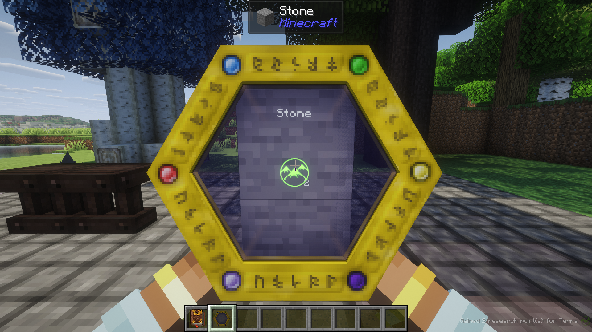

## Features

- **Old mods, unmodified.** For each version, Legacy Connector provides that old game's API itself: the engine, block and item ids, world generation, packets, and the rendering of old blocks and items. So even mods that use the game's internals run: Thaumcraft, Witchery, BuildCraft, Thermal Expansion, RedPower and more.
- **Plays well with modern mods.** Legacy content joins the game the way a modern mod's does: biomes, placed features, loot tables, village pools, data packs. It works with your other mods, and data packs can tweak it.
- **Containers are capabilities.** Legacy machines and items are NeoForge item, fluid and energy capabilities: RF and Forge Energy, IC2 EU and BuildCraft MJ. Hoppers, Create and modern cables work with them.
- **Outdated libraries are bridged** to their modern equivalents instead of being loaded: Baubles to Curios, Waila to Jade, NEI to JEI, Patchouli to Patchouli, and CoFH RF to NeoForge energy.
- **Coremods.** Coremods that patch other mods run as they did. Coremods that patch Minecraft's own classes are replayed at the matching places of the modern game; this is experimental.
- **Servers too.** Legacy mods run on a dedicated server. Client-only mods are skipped there.
- **Fast after the first launch.** Translations are cached, and `logs/legacyconnector-report.txt` lists what was detected for each jar.

## Supported versions

| Legacy version | Folder | Maturity | Known to work (examples) |
| --- | --- | --- | --- |
| **1.7.10** | `mods/1.7.10/` | ✅ Beta (the most complete) | Thaumcraft 4, Witchery, HBM's Nuclear Tech, the Reika mods, OreSpawn, Fisk's Superheroes, Morph, Galacticraft |
| **1.12.2** | `mods/1.12.2/` | ✅ Beta | Atum 2, The Midnight, The Betweenlands, Scape and Run: Parasites, Abyssalcraft |
| **1.6.4** | `mods/1.6.4/` | ✅ Beta | Tinkers' Construct, Mo' Creatures, Twilight Forest, Forestry |
| **1.5.2** | `mods/1.5.2/` | 🧪 Alpha | Twilight Forest, Applied Energistics 1, BuildCraft, ComputerCraft |
| **1.4.7** | `mods/1.4.7/` | 🧪 Alpha | RedPower 2, BuildCraft, ComputerCraft, Applied Energistics |
| **Forge 1.20.1** | `mods/1.20.1/` | 🧪 Alpha (remapped in place) | CoFH Core, Thermal Foundation, Terramity, Palladium, Another Furniture |
| **Beta 1.7.3** | `mods/b1.7.3/` (jars or zips) | 🧪 Alpha (contributor-maintained) | ModLoader and Forge 1.0 era mods |
| 1.2.5 | `mods/1.2.5/` | 🧪 Alpha | Small ModLoader / early Forge mods |
| 1.19.2, 1.18.2, 1.16.5 | | Planned | Stages on top of the 1.20.1 support |

Not planned: 1.8 to 1.11.2, and the Alpha/early-Beta jar-mod era. Details per version are under "What to expect per version" below.

## Download

- **Releases** (here, and on the other platform and GitHub) are tested and come less often, with more changes in each.
- **Nightly builds:** every change to the source is also built automatically and published as the [Nightly release on GitHub](https://github.com/kylepitcock/Legacy-Connector/releases/tag/nightly). It is one pre-release, replaced each time; the version is in the jar name. It has the newest fixes but is untested, so back up your world and name the nightly version when you report a problem.

## Installation

1. Create a **Minecraft 1.21.1 / NeoForge 21.1.x** profile (Java 21) and install Legacy Connector.
2. Download the versions of the mods you want that match the table above from their CurseForge or Modrinth pages (Files tab, filter by game version).
   - The CurseForge app won't add old-version mods to a 1.21.1 profile, so add them by hand: in the app, open your profile, click **⋯ → Open Folder**, and drop the jars into `mods`.
3. If a mod needs a library (CodeChickenLib, CoFH Core, etc.), add that library's jar for the same old version too.
4. Each version has its own folder inside `mods`:

   `mods/1.7.10/`, `mods/1.12.2/`, `mods/1.6.4/`, `mods/1.5.2/`, `mods/1.4.7/`, `mods/1.20.1/`, `mods/b1.7.3/`, `mods/1.2.5/`

   Legacy jars you drop into `mods` itself are moved there for you on launch (`legacy.autoSortMods=false` turns that off).
5. **Start the game.** The first launch translates each legacy jar, with a progress bar on the loading screen. The result is cached, so later launches are fast.
6. **Check `logs/legacyconnector-report.txt`** to see what was translated and anything that couldn't be linked. If a legacy mod needs a library that isn't installed, NeoForge's "Warnings while loading mods" screen names the mod, the dependency and the folder to put it in. The mod is still loaded.

**Two things to watch for:**
- **Jars that bundle their own Mixin** (common in 1.12.2, e.g. Spartan Weaponry) must be in their version folder before the first launch. In `mods`, NeoForge loads them as launcher plugins before they can be translated, and the game stops with "Module ... contains package org.spongepowered...".
- **Some file names are rejected by NeoForge** before any mod runs, for example a version part that starts with a dot (`HBM-NTM-.1.0.27_X5863.jar`). Rename such a jar or put it into its folder by hand.

---

## What to expect per version

The link figures are an offline check of release 0.4.14 (2026-11-13): how many of the jars probed have all their references resolved. Linking is not the same as working in play; per-mod results are on the [compatibility site](https://kylepitcock.github.io/Legacy-Connector/).

- **1.7.10 (beta, the most complete; 528 of 611 jars link):** Thaumcraft 4, Witchery, HBM's Nuclear Tech, OreSpawn, Fisk's Superheroes, Morph, the Reika mods (RotaryCraft, ReactorCraft, ElectriCraft, ChromatiCraft) and Galacticraft with its addons (each planet's own gravity) run with their blocks, items, mobs, recipes, GUIs, world generation and dimensions. Big packs like GT New Horizons load most of their mods. In-game tests of that pack and a 130-jar list rate 166 mods as working and 57 as partly working.
- **1.12.2 (beta; 578 of 645 jars link):** Atum 2, The Midnight, The Betweenlands, Scape and Run: Parasites and Abyssalcraft load and play with their own models, mobs, GUIs, dimensions and world generation. Mod fluids are real fluids with buckets, and items with subtypes become one item each. Modern containers and items are visible to old mods (pipes of an old mod can use a modern barrel), and blocks drawn by a mod's own renderer through CodeChickenLib work (Thermal Dynamics ducts). Some mods (Applied Energistics 2, EnderIO, Industrial Foregoing, Extra Utilities 2) still have rendering defects.
- **1.6.4 (beta; 35 of 45):** a layer over the 1.7.10 support. Tinkers' Construct (smeltery included), Mo' Creatures, Twilight Forest, Forestry, IndustrialCraft 2 and others were played in survival. Thaumcraft 4 is missing.
- **1.5.2 (alpha; 35 of 38) and 1.4.7 (alpha; 45 of 49):** small deltas over 1.6.4. Twilight Forest, Applied Energistics 1 and BuildCraft (1.5.2) and RedPower 2, BuildCraft, ComputerCraft and Applied Energistics (1.4.7) run in a real client. Mods that replace Minecraft's own classes in a patched `minecraft.jar` (Better Than Wolves) cannot work.
- **Forge 1.20.1 (alpha; 99 of 494 jars of the ATM 9 pack, 152 in the nightly build):** mods are remapped in place onto NeoForge 1.21.1, with Forge API facades, data conversion and soft links for removed API. Mixins whose targets changed are repaired or dropped one by one instead of failing the mod, and item NBT in recipes and loot becomes data components. On a server a 108-mod subset of an ATM 9 pack loads with 0 failures. In a client single mods such as CoFH Core, Thermal Foundation, Redstone Arsenal and Ensorcellation reach a world, and Terramity, Palladium with its addon packs and Another Furniture run; the combined ATM 9 set does not reach a world in a client yet. 141 of the 506 mods of the pack link; most other 1.20.1 mods still have unresolved references, and most of the rest have a native 1.21.1 version anyway. Contributions by kentvillamor08.
- **1.2.5 (alpha, on by default):** ModLoader / early Forge mods are translated to the 1.4.7 layer; `versions.minecraft125=false` in `config/legacyconnector.properties` turns it off (the release and nightly jars carry the needed name table). About a dozen small mods (Obsidian Hilt, BucketCraft, Magic Wands, Backpack, Elemental Creepers and others) register and draw their content in a real client; six small mods (Obsidian Hilt, BucketCraft, Craftable Mob Spawners, Magic Wands, Elemental Creepers, Backpack) were played in survival and keep their items and blocks across a save and restart; expect other mods to load and then do little.
- **Beta 1.7.3 (alpha; 38 of 44 archives link, 20 of them through placeholder APIs):** ModLoader and Forge 1.0 era mods load with their own textures, block behaviour, tile entities and GUIs, and supported mob families run their original callbacks. Entities and world generation are still incomplete. Contributed by Zekken01.

---

## Screenshots

All taken in a real game client on NeoForge 1.21.1, with unmodified legacy mods that have no modern version running next to modern content.

**A Thaumcraft 4 workshop: infusion altar, crucible, alembics, essentia jars, research table, an aura node, and magical trees**

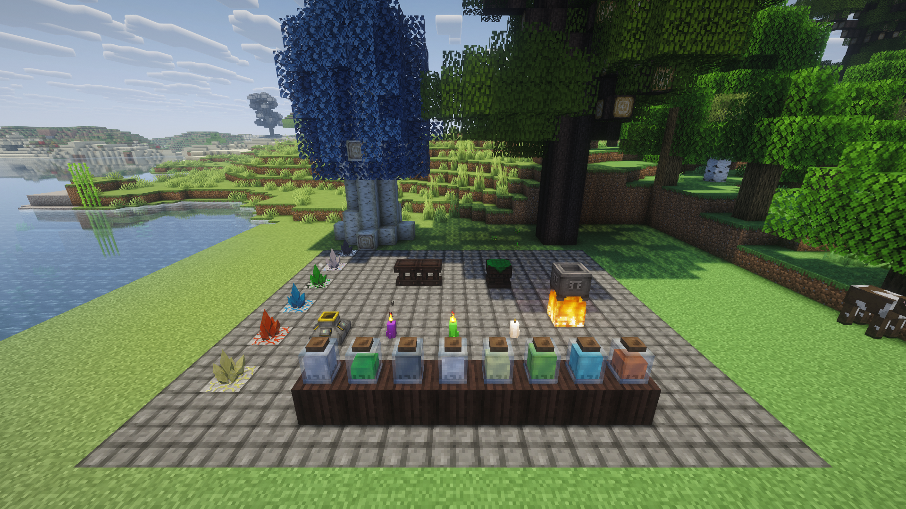

**A Create Aeronautics airship (Sable physics) carrying 1.7.10 blocks: Thaumcraft essentia jars, crucible and arcane workbench, an Iron Chest, a RotaryCraft engine, and ChromatiCraft crystals**

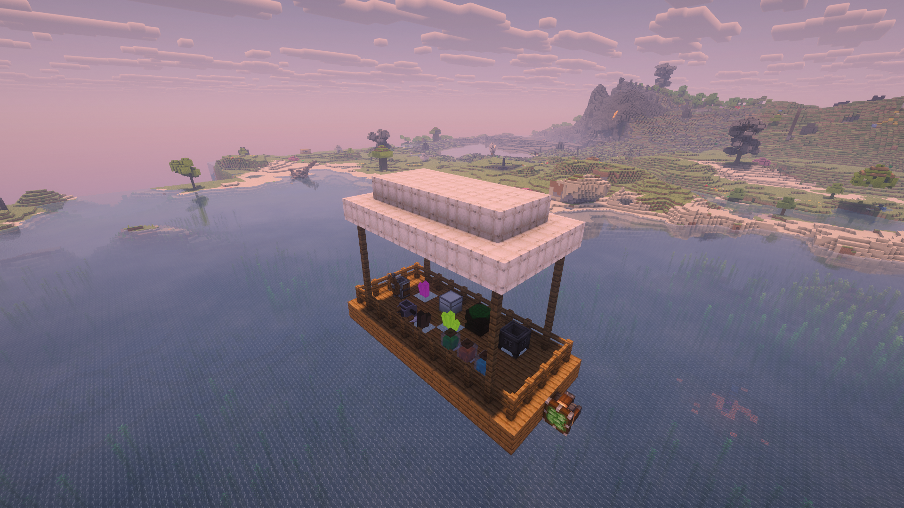

**A Witchery ritual site: chalk circle, altar, witch's oven, kettle, distillery, and spinning wheel, crops, and Witchery creatures**

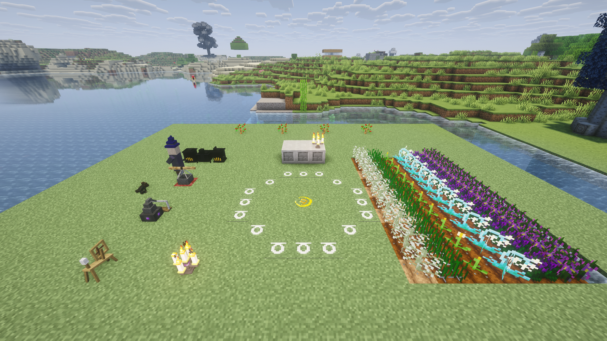

**Fisk's Superheroes: Doctor Octopus with his tentacles deployed and the suit's abilities**

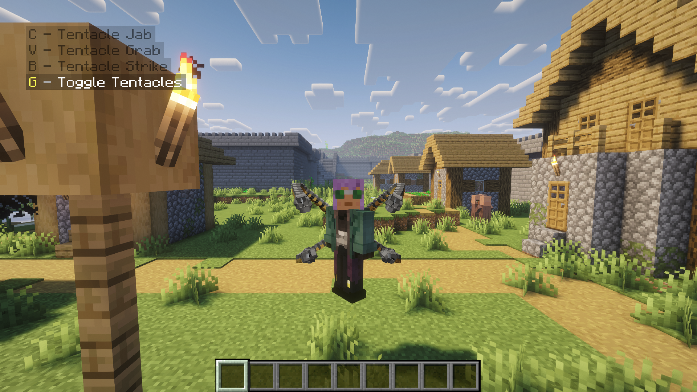

**OreSpawn's The King, with a modern boss bar**

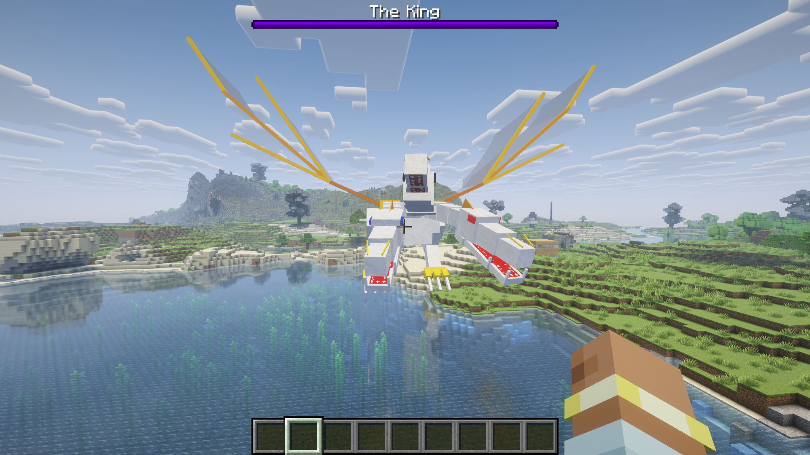

**A vanilla village in All the Mods 10 with Witchery's town walls, keep, and watchtowers, and Thaumcraft's wizard tower, built by their legacy village code**

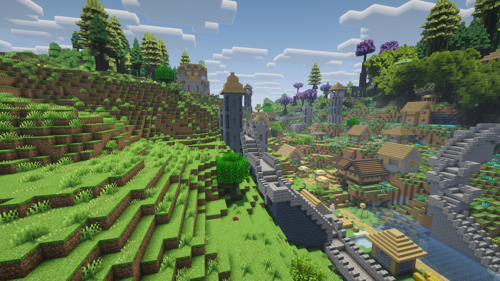

**A nuclear explosion from HBM's Nuclear Tech Mod, drawn by its own effect code**

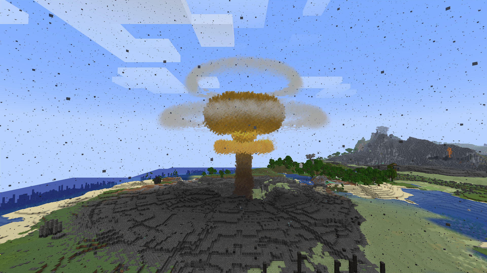

**1.12.2: Atum 2, the desert dimension, with its pyramids, sandstorm haze, and creatures**

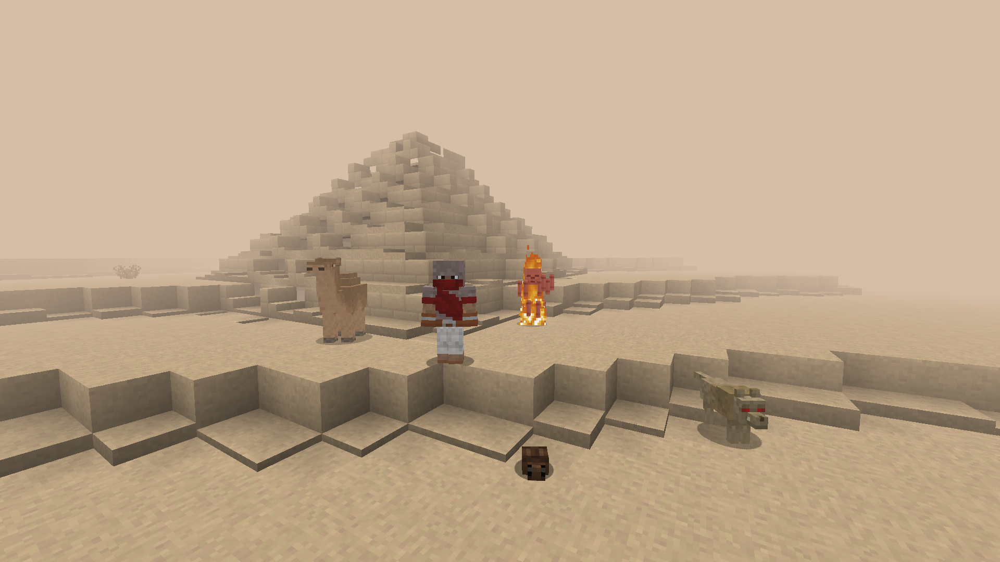

**1.12.2: Scape and Run: Parasites**, with its own models and renderers:

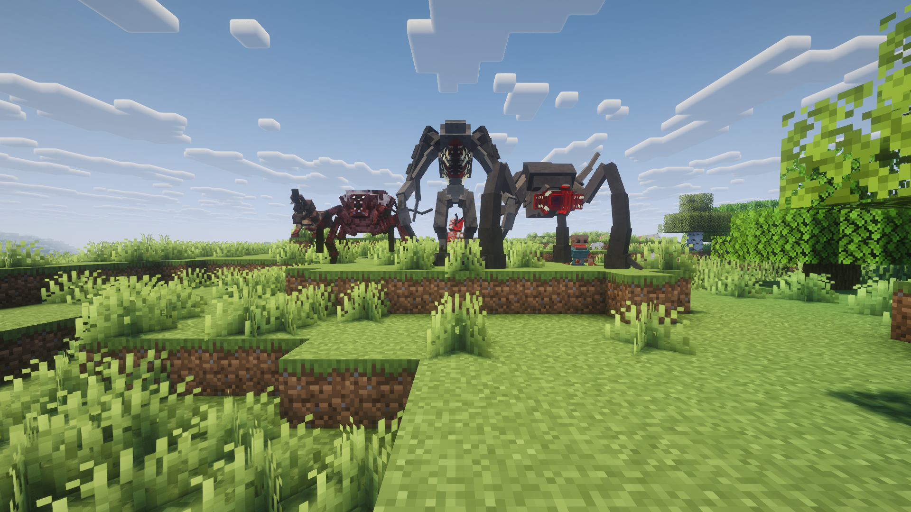

**1.12.2: The Midnight**, the Deceitful Bog with its own biomes, Bogshrooms, and night sky:

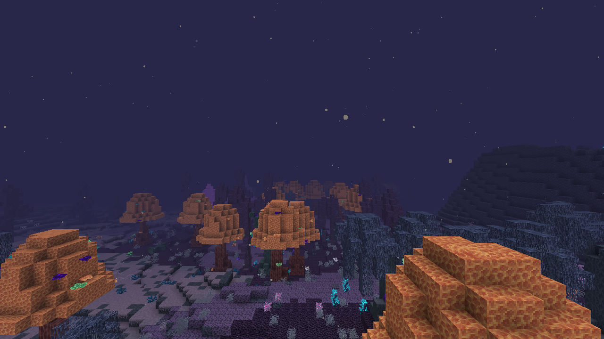

---

## How it works

1. **Inspect:** detects legacy mods and their Minecraft version from `mcmod.info`, `mods.toml`, `@Mod` annotations, and FML references
2. **Translate:** remaps old Minecraft/Forge classes and names, and fixes Java 8 → 21 and LWJGL 2 → 3 incompatibilities (1.20.1 mods are remapped in place)
3. **Link:** every legacy API call resolves against a hand-written re-implementation of that version's API built on NeoForge. Anything not implemented yet is generated automatically, so mods *load* instead of crashing with `NoClassDefFoundError`
4. **Convert resources:** lang files, textures, blockstates and models are converted to 1.21 formats

Mods work because the legacy API they were written against is rebuilt on top of NeoForge, not because of patches for individual mods. Mod-specific fixes are a rare last resort, kept small and isolated.

## What's bridged

Per version, some items differ; the notes in brackets say where.

- **Registries, blocks, items and tile entities:** metadata subtypes become real items and NBT is preserved (1.12.2: block states through one `meta` property, one item per subtype; 1.4.7 to 1.7.10: numeric ids)
- **Recipes and smelting:** converted to data-pack recipes, including mods' custom recipe types (1.7.10: IC2, AE2, Blood Magic, Witchery). The Ore Dictionary becomes tags
- **Loot, fishing and brewing:** items mods add to dungeon, mineshaft, temple, stronghold and village chests appear in the matching vanilla loot tables; fishing catches and brewing recipes of mods work (1.7.10)
- **Entities:** legacy mobs spawn naturally, tick, use their own AI, fight and save, with their own renderers and models. Legacy bosses get a boss health bar
- **GUIs and HUD:** mods' own custom GUIs and HUD overlays; Custom Main Menu can replace the title screen (1.7.10)
- **Fluids:** flow, render and are NeoForge fluid capabilities (1.12.2: real fluids with buckets)
- **Containers and energy:** legacy tiles and items are NeoForge item, fluid and energy capabilities by default (RF and Forge Energy, IC2 EU, BuildCraft MJ), so hoppers, Create and modern cables work with them. Modern containers and items are visible to 1.12.2 mods
- **Networking, commands, sounds, potions, creative tabs, dispensers, achievements and events**
- **Villagers and villages:** modded professions and trades appear on villagers, and mods' village buildings (Witchery's shops and towers, AgriCraft's greenhouses) generate inside modern villages (1.7.10)
- **World generation and dimensions:** mod biomes become real 1.21 biomes, mod world types appear on the Create World screen (1.12.2 ones from 0.5.3, with vanilla terrain for now), ore generators, dungeons and structures run normally, and mod dimensions run their own terrain, biomes, fog, clouds and sky, with per-dimension gravity (Galacticraft's planets have low gravity and space is silent)
- **Deepslate ores:** legacy ores also generate below y=0 and get an automatic deepslate variant with the same drops and behaviour
- **Block and item rendering:** custom block render handlers, tile entity renderers, item renderers, OBJ and Techne models and mods' own texture loaders (1.12.2: also blocks drawn through CodeChickenLib)
- **Coremods that patch other mods** (CoFH, AE2, OpenMods and more) and **Scala mods** (1.7.10)
- **Mod-specific libraries:** `@Config` classes are filled from their config files, `@ObjectHolder`, `@SidedProxy` and `@EventBusSubscriber` work (1.12.2)

**Experimental:** coremods that patch *Minecraft's own* 1.7.10 and 1.12.2 classes (Fisk's Superheroes, Legends, AppleCore, Quark). Legacy Connector reads the hooks they insert into the original 1.7.10 classes and calls them from the matching places of the modern game (movement, gravity, healing, attacks, weather, player model poses and more); hooks without a modern counterpart yet do nothing, and the log says how many are replayed. This needs the original Minecraft 1.7.10 client jar, which is not shipped: it is found when 1.7.10 is installed in your launcher, and otherwise downloaded once from Mojang (`coremods.vanillaJar` names a local copy, `coremods.downloadVanilla=false` turns the download off). Without it the mods still load, without those hooks. The 1.6.4, 1.5.2 and 1.4.7 versions are read the same way, with few places so far. Mods that replace Minecraft's classes wholesale (Better Than Wolves) cannot work. Engine and launcher patches (FastCraft, Hodgepodge, NEID and other ID extenders, FoamFix, BetterFPS, VanillaFix) are skipped on purpose, since they only make sense on the old engine.

### Modern replacements for outdated libraries

| Legacy | Becomes | Notes |
| --- | --- | --- |
| Baubles | **Curios** | Bauble items go into Curios slots |
| NotEnoughItems | **JEI** | Legacy recipe handlers become JEI categories and answer recipe/usage lookups; NEI is never loaded when JEI is present |
| JEI (1.12.2) | **JEI** | Legacy JEI plugins run: their categories, catalysts and click areas show in the modern JEI |
| Waila | **Jade** | Legacy tooltip providers show in Jade |
| Patchouli (1.12.2) | **Patchouli** | Legacy mods' guide books (including the ones they ship as resources) open in the modern Patchouli |
| CoFH RF API (1.7.10 and Redstone Flux 1.12.2) | **NeoForge Energy** | Always on. 1 RF = 1 FE, so modern cables connect |

If the modern mod isn't installed, the legacy library loads as usual. Each replacement can also be turned off in the config to load the legacy library instead. TerraBlender and Pehkui are embedded in Legacy Connector; a separately installed newer one wins.

### Create contraptions and Create Aeronautics ships

Create contraptions and Create Aeronautics/Sable ships can carry legacy blocks (1.7.10 and 1.12.2): tile entity data and inventories move with the block, and blocks that legacy pistons could not move are refused. Tested in game with a mechanical bearing and an Aeronautics airship (1.7.10: Iron Chest, Thaumcraft, RotaryCraft, ChromatiCraft). Limitations: blocks are not rotated when placed back turned, and legacy inventories are not contraption storage.

## Performance

Thaumcraft 4 measured against no legacy mods in a real client: about +38 MB of heap after a full GC. Frame rate and tick
time vary more between identical runs than between the two setups. Loading Thaumcraft takes about 5.5 s per launch;
translating its jar adds about 0.5 s on the first launch only (the result is cached). Details are in the [documentation on GitHub](https://github.com/kylepitcock/Legacy-Connector/blob/master/docs/wiki/Home.md).

## Changing legacy recipes

Legacy recipes are normal modern recipes with stable ids (`<mod>:<kind>/<output item>`, e.g. `ic2:shaped/macerator`), in a pack
below your world data packs. Replace or remove them with a data pack, edit them with KubeJS (`event.remove({mod: 'ic2'})`), or
keep using MineTweaker 3 scripts (1.7.10): `recipes.addShaped`, `recipes.remove`, `furnace.addRecipe` and `furnace.remove`
become modern recipes. KubeJS changes also apply in mod crafting tables, autocrafters and furnaces. Removing vanilla recipes from MineTweaker scripts is not supported yet; use a data pack or KubeJS for those.

## Configuration

Settings are in `config/legacyconnector.properties`. The file is created with comments on first launch, and you can also edit it in game under *Mods → Legacy Connector → Config*. Common ones:

| Setting | Default | What it does |
| --- | --- | --- |
| `mods.skip` | empty | Legacy mod ids to leave out entirely |
| `bridges.<name>.enabled` | `true` | `false` loads the legacy library (`baubles`, `waila`, `nei`, `cofhEnergy`, `patchouli`) instead of its modern replacement |
| `versions.minecraft125`, `experimental.forge1201` | `true` | Turn 1.2.5 or Forge 1.20.1 support off |
| `deepLayer.enabled` | `true` | Spreads legacy ores down to the modern world bottom, with the same amount per chunk as the original mod |
| `legacyBiomeFrequency` | `1.0` | How much overworld land legacy biomes take (`0` = none in new chunks) |
| `villages.legacyBuildings` | `true` | Legacy village buildings join the vanilla village pools |
| `modernizeTextures` | `true` | Swaps old vanilla art inside legacy textures for the modern vanilla textures |

Every key (textures, ore backgrounds, world height, coremods, energy rates, performance switches, ...) is on the [Configuration page](https://github.com/kylepitcock/Legacy-Connector/blob/master/docs/wiki/Configuration.md).

## FAQ

**What does it do?** It runs mods that were built for older Minecraft versions (Forge 1.4.7, 1.5.2, 1.6.4, 1.7.10, 1.12.2, 1.20.1, and ModLoader-era Beta 1.7.3) on NeoForge 1.21.1, next to modern mods. Legacy jars are translated when the game loads; the original file is never modified.

**How is it different from Retromod and Retrofit?** They are different tools. These summaries come from their own project pages, so check those for the details.
- [Retromod](https://modrinth.com/mod/retromod) (MIT) also rewrites old mods' bytecode when the game loads. It supports Forge, NeoForge, Fabric and Quilt, and its pages recommend it for content, quality-of-life and library mods, not for mods that hook deep into the game (Create, Tinkers, Applied Energistics and similar).
- [Retrofit](https://github.com/Astryxx/Retrofit) (Astryxx) is an interoperability mod: it lets 1.7.10 and 1.20.1 mods work together (energy systems such as RF and IC2, ore dictionary and tags). It does not load old mods onto a modern game.
- Legacy Connector is for NeoForge 1.21.1 only. For each old version it provides the old game's API itself (the engine, ids, world generation, packets, rendering of the old blocks and items), so mods that use the game's internals can run: Thaumcraft, BuildCraft, Thermal Expansion, RedPower and many more. It bridges outdated libraries to modern equivalents and exposes legacy containers as NeoForge capabilities.

**Where do I put the mods?** Each legacy version has its own folder, see Installation above.

**Will mod X work?** Check the compatibility site. After a launch, `logs/legacyconnector-report.txt` lists each legacy jar, what was detected, and any references that could not be translated or are only stubbed. Mods that only patch the old engine are skipped on purpose, and coremods that patch Minecraft's own classes are only partly supported (see above).

**Does it work on a dedicated server?** Yes. Legacy mods run on a dedicated server too; client-only mods are skipped there.

**Does it work on Fabric or Forge?** No. It is a NeoForge 1.21.1 mod. (Fabric mods on NeoForge are what Sinytra Connector does; Legacy Connector is the equivalent for old Forge versions.)

**Something broke. How do I report it?** Run `/legacyconnector report` in the game (0.5.3 and later): it writes one zip with the logs and the mod list, with your user name and paths removed. Attach it to a [GitHub issue](https://github.com/kylepitcock/Legacy-Connector/issues). Without the command, attach `logs/latest.log` and `logs/legacyconnector-report.txt` as files (and the crash report if there is one). Please say the Legacy Connector version (for a nightly, the full version), the mod and its Minecraft version, and what you did. Crash reports of a translated mod belong here, not with the mod's author.

## Troubleshooting

After launching, check **`logs/legacyconnector-report.txt`**. For each legacy jar, it lists the detected version, the mod IDs, any unresolved references, and which APIs are stubbed. Known issues and workarounds are on the [GitHub page](https://github.com/kylepitcock/Legacy-Connector/blob/master/docs/wiki/Compatibility-and-Status.md#known-compatibility-issues). Please report results on the [compatibility site](https://kylepitcock.github.io/Legacy-Connector/).

**The game stops on launch with "Module ... contains package org.spongepowered...":** a jar in `mods/` bundles its own Mixin (Spartan Weaponry, MixinBooter mods, SuperMartijn642's Core Lib). NeoForge loads such jars as launcher plugins before any mod code (including Legacy Connector) can run, so this cannot be fixed from inside the mod. Move the jar into its version folder (for example `mods/1.12.2/`); Legacy Connector reads those folders and removes the bundled Mixin when it translates the jar.

**A legacy mod is not picked up from `mods/`:** NeoForge rejects some file names (a version part that starts with a dot) before any mod runs. Rename the jar or put it into its version folder by hand.

**"Warnings while loading mods":** it names a legacy mod, a dependency it needs and the folder for the dependency's jar. The mod is still loaded.

### Commands (operator)

| Command | What it does |
| --- | --- |
| `/legacyconnector mods` | List loaded legacy mods |
| `/legacyconnector list <blocks/items/entities> <mod>` | List a mod's IDs |
| `/legacyconnector inspect` | Describe the block or entity you're looking at (legacy class, metadata, tile entity, render type) |
| `/legacyconnector give <item> [meta] [count]` | Give a legacy item with metadata |
| `/legacyconnector place <block> [meta]` | Place a legacy block with metadata |
| `/legacyconnector spawn <entity> [count]` | Spawn a legacy mob |
| `/legacyconnector gui <mod> <id> [pos]` | Open a mod's GUI by its handler ID |
| `/legacyconnector dim list` / `dim <id> [pos]` | List or travel to legacy mod dimensions |
| `/legacyconnector biome <id>` | Jump to a legacy biome |

IDs tab-complete.

## Writing addons

Other NeoForge mods can add modern support to legacy mods (every supported version) through a small public API (version 0.3): lifecycle events, access to legacy classes,
modern/legacy stack and tile conversion, and NeoForge capabilities for legacy tile entities. Guide, support matrix and example addon (modern aspects for Thaumcraft 4):
[Addon API](https://github.com/kylepitcock/Legacy-Connector/blob/master/docs/wiki/Addon-API.md).

## Roadmap

✅ 1.7.10 → ✅ **1.12.2** (beta) → **1.6.4** (beta) → **1.5.2** (alpha) → **1.4.7** (alpha) → **1.20.1** (alpha) → **1.2.5** (alpha, pulled forward 2026-11-16) → **1.19.2** → **1.18.2** → **1.16.5**

Beta 1.7.3 (alpha) was added on a contributor's request, outside this order. 1.19.2, 1.18.2 and 1.16.5 are planned as a chain of stages on top of the 1.20.1 pipeline ([plan](https://github.com/kylepitcock/Legacy-Connector/blob/master/docs/wiki/Legacy-1.16-1.19-Plan.md), [roadmap](https://github.com/kylepitcock/Legacy-Connector/blob/master/docs/wiki/Version-Roadmap.md)). 1.8 to 1.11.2 are not planned.

## Credits

- Beta 1.7.3 support: contributed and maintained by Zekken01.
- Palladium and its addon packs on Forge 1.20.1: contributed by kentvillamor08.
- Thanks to everyone who tests mods and reports what works on the [compatibility site](https://kylepitcock.github.io/Legacy-Connector/) and in the issues.

## Star history

---

**Modpacks:** anyone may include Legacy Connector in a modpack, on any platform, without asking for permission. This covers Legacy Connector only; the legacy mods you put next to it keep their own licenses.

**Legal:** Legacy Connector is released under the MIT License. It contains no Minecraft, Forge or third-party mod code. You supply your own mod jars; please don't redistribute them. Third-party notices (including MIT-licensed portions adapted from Retromod): [THIRD_PARTY_NOTICES.md](https://github.com/kylepitcock/Legacy-Connector/blob/master/THIRD_PARTY_NOTICES.md).

[CurseForge](https://www.curseforge.com/minecraft/mc-mods/legacy-connector) · [Source & issue tracker (GitHub)](https://github.com/kylepitcock/Legacy-Connector) · [Compatibility list](https://kylepitcock.github.io/Legacy-Connector/)
