<div align="center">


# Legacy Connector

**Run unmodified legacy Forge mods on NeoForge 1.21.1.**

[](https://modrinth.com/mod/legacyconnector)
[](https://www.curseforge.com/minecraft/mc-mods/legacy-connector)
[](https://discord.gg/vC6x4Kwwdq)
[](https://ko-fi.com/kylepitcock)

[](https://github.com/kylepitcock/Legacy-Connector/releases/latest)
[](https://github.com/kylepitcock/Legacy-Connector/releases/tag/nightly)
[](https://neoforged.net/)
[](https://neoforged.net/)
[](LICENSE)

[**Compatibility list**](https://kylepitcock.github.io/Legacy-Connector/) ·
[**Download**](#download) ·
[**Wiki**](docs/wiki/Home.md) ·
[**Report a problem**](https://github.com/kylepitcock/Legacy-Connector/issues)

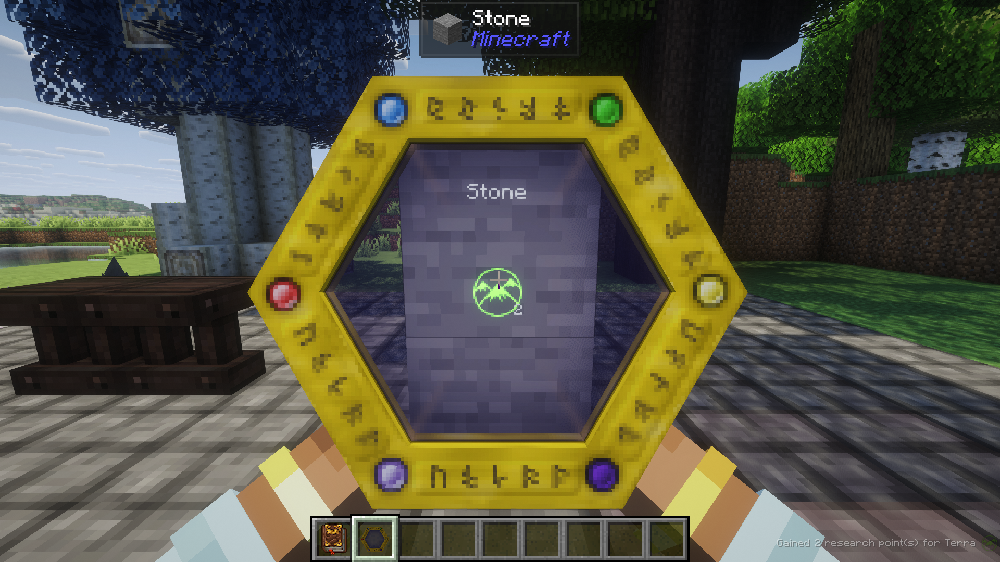

</div>

## About

Legacy Connector loads mods built for **Minecraft 1.7.10, 1.12.2, 1.6.4, 1.5.2, 1.4.7, Forge 1.20.1 and Beta 1.7.3** (1.2.5 in alpha) next to
modern NeoForge 1.21.1 mods. Each legacy jar is translated when the game loads and runs as a normal NeoForge mod, the same way
[Sinytra Connector](https://github.com/Sinytra/Connector) runs Fabric mods on NeoForge. The original jars are never modified.

It is meant for the mods that **only exist on these old versions** and never got a 1.21.1 port.

> [!WARNING]
> Maturity differs per version (see [Supported versions](#supported-versions)). Back up your worlds before you try a new mod set.

## Features

- **Old mods, unmodified.** For each version, Legacy Connector provides that old game's API itself: the engine, block and item ids, world generation, packets, and the rendering of old blocks and items. So even mods that use the game's internals run: Thaumcraft, Witchery, BuildCraft, Thermal Expansion, RedPower and more.
- **Plays well with modern mods.** Legacy content enters the game through the hooks a modern mod uses: biomes, placed features, loot tables, village pools, data packs. It works with the pack's other mods, and data packs can tune it.
- **Containers are capabilities.** Legacy tile entities and items are NeoForge item, fluid and energy capabilities: RF and Forge Energy, IC2 EU and BuildCraft MJ. Hoppers, Create and modern cables work with them.
- **Outdated libraries are bridged** to their modern equivalents instead of being loaded:
  - Baubles to Curios
  - Waila to Jade
  - NEI and JEI 1.12 to JEI
  - Patchouli books to Patchouli
  - CoFH RF / Redstone Flux to NeoForge energy

  Each bridge can be switched off ([Bridges](docs/wiki/Bridges.md)). TerraBlender (legacy biomes become a TerraBlender region) and Pehkui (entity size) are embedded; a separately installed newer copy wins.
- **Coremods** that patch other mods run as they did. Coremods that patch Minecraft's own classes are replayed at the matching places of the modern game. This is experimental; see the [FAQ](#faq).
- **Servers too.** Legacy mods run on a dedicated server. Client-only mods are skipped there.
- **Fast after the first launch.** Translations are cached, and `logs/legacyconnector-report.txt` lists what was detected for each jar.

## Supported versions

| Legacy version | Folder | Maturity | Known to work (examples) |
|---|---|---|---|
| 1.7.10 | `mods/1.7.10/` | **Beta** (the most complete) | Thaumcraft 4, Witchery, HBM's Nuclear Tech, the Reika mods, OreSpawn, Fisk's Superheroes, Morph, Galacticraft and its addons; GT New Horizons loads most of its mods |
| 1.12.2 | `mods/1.12.2/` | **Beta** | Atum 2, The Midnight, The Betweenlands, Scape and Run: Parasites, Abyssalcraft; mod fluids are real fluids with buckets |
| 1.6.4 | `mods/1.6.4/` | **Beta** | Tinkers' Construct (smeltery included), Mo' Creatures, Twilight Forest, Forestry (played in survival) |
| 1.5.2 | `mods/1.5.2/` | Alpha | Twilight Forest, Applied Energistics 1, BuildCraft, ComputerCraft, Forestry |
| 1.4.7 | `mods/1.4.7/` | Alpha | RedPower 2, BuildCraft, ComputerCraft, Applied Energistics |
| Forge 1.20.1 | `mods/1.20.1/` | Alpha | Remapped in place onto 1.21.1. CoFH Core, Thermal Foundation, Redstone Arsenal, Ensorcellation, Terramity, Palladium and Another Furniture reach a world; a 108-mod ATM 9 subset loads on a server, but the whole ATM 9 set does not reach a world in a client yet |
| Beta 1.7.3 | `mods/b1.7.3/` | Alpha (contributor-maintained) | ModLoader and Forge 1.0 era mods: blocks, items, recipes, tile entities, GUIs, supported mob families; entities and world generation are incomplete |
| 1.2.5 | `mods/1.2.5/` | Alpha | Small ModLoader / early Forge mods, translated to the 1.4.7 layer; the big Forge-era mods are only link-probed, so expect mods that load and then do little ([status and limits](docs/wiki/Legacy-1.2.5.md)) |
| 1.19.2, 1.18.2, 1.16.5 | | Planned | Built on top of the 1.20.1 pipeline ([plan](docs/wiki/Legacy-1.16-1.19-Plan.md)) |

Not planned: 1.8 to 1.11.2, and the Alpha/early-Beta jar-mod era.

More detail:
- Per-mod results: the [compatibility site](https://kylepitcock.github.io/Legacy-Connector/).
- Probe figures and known problems: [Compatibility and status](docs/wiki/Compatibility-and-Status.md).
- Order and reasons: [Version roadmap](docs/wiki/Version-Roadmap.md).
- What changed recently: [release notes 0.5.2](docs/release-notes/0.5.2.md).

## Download

| Channel | Where | When to use it |
|---|---|---|
| **Release** | [Modrinth](https://modrinth.com/mod/legacyconnector) · [CurseForge](https://www.curseforge.com/minecraft/mc-mods/legacy-connector) · [GitHub](https://github.com/kylepitcock/Legacy-Connector/releases/latest) | Tested builds. They come less often and collect more changes. |
| **Nightly** | [GitHub pre-release `nightly`](https://github.com/kylepitcock/Legacy-Connector/releases/tag/nightly) | Built from every push to `master`, so it gets a fix before the next release. Untested: back up your world, and name the nightly version (it is in the jar name) when you report a problem. |

## Installation

1. Install **NeoForge 21.1.x** for Minecraft 1.21.1 (Java 21) and put Legacy Connector into `mods/`.
2. Put the legacy mods, and the libraries they need (CodeChickenLib, CoFH Core, ...), into the folder of their Minecraft version:

   ```
   mods/
     legacyconnector-<version>.jar
     1.7.10/   1.12.2/   1.6.4/   1.5.2/   1.4.7/   1.20.1/   b1.7.3/   1.2.5/
   ```

   Jars you drop into `mods/` itself are moved there on launch (`legacy.autoSortMods=false` turns that off).
3. **Start the game.** The first launch translates each legacy jar, with a progress bar on the loading screen. The result is cached, so later launches are fast.
4. **Check `logs/legacyconnector-report.txt`.** For every jar it lists what was detected, which references could not be linked and which APIs were synthesized.

If a legacy mod needs a library that is not installed, NeoForge's "Warnings while loading mods" screen names the mod, the dependency and the folder to put it in. The mod is still loaded.

> [!NOTE]
> Two things to watch for (details in [Troubleshooting](docs/wiki/Troubleshooting.md)):
> - **Jars that bundle their own Mixin** (common in 1.12.2: Spartan Weaponry, MixinBooter mods) must be in their version folder before the first launch. In `mods/`, NeoForge loads them as launcher plugins before they can be translated, and the game stops with "Module ... contains package org.spongepowered...".
> - **Some file names are rejected by NeoForge** before any mod runs, for example a version part that starts with a dot (`HBM-NTM-.1.0.27_X5863.jar`). Such a jar is not sorted for you: put it into its version folder by hand, or rename it.

## Configuration

Settings are in `config/legacyconnector.properties`. The file is written with defaults and comments on first start, and you can also edit it in game under *Mods → Legacy Connector → Config*. Common ones:

| Key | Default | Effect |
| --- | --- | --- |
| `mods.skip` | empty | Legacy mod ids to leave out entirely |
| `bridges.<name>.enabled` | `true` | `false` loads the legacy library (`baubles`, `waila`, `nei`, `cofhEnergy`, `patchouli`) instead of its modern replacement |
| `versions.minecraft125`, `experimental.forge1201` | `true` | Turn 1.2.5 or Forge 1.20.1 support off |
| `deepLayer.enabled` | `true` | Spread legacy ores down to the modern world bottom (same total per chunk as the original mod) |
| `legacyBiomeFrequency` | `1.0` | How much overworld land legacy biomes take (`0` = none in new chunks) |
| `villages.legacyBuildings` | `true` | Legacy village buildings join the vanilla village pools |
| `modernizeTextures` | `true` | Swap old vanilla art inside legacy textures for the modern vanilla textures |

Every key (textures, ore backgrounds, world height, coremods, energy rates, `perf.*` switches, ...) is documented on the [Configuration](docs/wiki/Configuration.md) page.

## FAQ

<details>
<summary><b>Will mod X work?</b></summary>

Check the [compatibility site](https://kylepitcock.github.io/Legacy-Connector/), then `logs/legacyconnector-report.txt` after a launch. Some mods won't run, by design or because they can't:
- Mods that only patch the old engine (performance patches, id extenders) are skipped on purpose.
- Mods that replace Minecraft's classes wholesale (Better Than Wolves and other patched-`minecraft.jar` mods) cannot work.
</details>

<details>
<summary><b>How is it different from Retromod and Retrofit?</b></summary>

They are different tools. These summaries come from their own project pages, so check those for the details.

- [Retromod](https://modrinth.com/mod/retromod) (MIT) also rewrites old mods' bytecode when the game loads.
  - It supports Forge, NeoForge, Fabric and Quilt.
  - Its pages recommend it for content, quality-of-life and library mods, not for mods that hook deep into the game (Create, Tinkers, Applied Energistics, and similar).
  - Some MIT-licensed portions of Retromod are adapted in this project (see [`THIRD_PARTY_NOTICES.md`](THIRD_PARTY_NOTICES.md)).
- [Retrofit](https://github.com/Astryxx/Retrofit) (Astryxx) is an interoperability mod. It lets 1.7.10 and 1.20.1 mods work together (energy systems such as RF and IC2, ore dictionary, tags). It does not load old mods onto a modern game.
- Legacy Connector is for NeoForge 1.21.1 only.
  - For each old version it provides the old game's API itself, so mods that use the game's internals can run.
  - It bridges outdated libraries to modern equivalents and exposes legacy containers as NeoForge capabilities.
</details>

<details>
<summary><b>What about coremods?</b></summary>

- **Coremods that patch other mods** run as they did.
- **Coremods that patch Minecraft's own 1.7.10 classes** (Fisk's Superheroes, Legends and the like) are partly supported, and this is experimental:
  - Legacy Connector shows their transformers the original 1.7.10 classes once and notes the hooks they insert.
  - It then calls those hooks from the matching places of the modern game: movement, gravity, natural healing, tick length, player attacks, weather, arm swing, sprint particles, entity removal, and player model render and pose.
  - Hooks in places with no modern counterpart yet do nothing. The log says how many are replayed.
- **This needs the original Minecraft 1.7.10 client jar**, which Legacy Connector does not ship.
  - It is found when 1.7.10 is installed in your launcher, and otherwise downloaded once from Mojang (`coremods.vanillaJar`, `coremods.downloadVanilla`).
  - Without it, the mods still load, without their hooks.
- **Coremods of other versions** (1.12.2: AppleCore, Quark, Charm, RandomThings; 1.6.4, 1.5.2, 1.4.7) are read the same way against their own client jar. 1.12.2 has places for many hooks, the older versions for few.

Details: [Coremods](docs/wiki/Coremods.md).
</details>

<details>
<summary><b>Does it work on a dedicated server?</b></summary>

Yes. Legacy mods run on a dedicated server too; client-only mods are skipped there.
</details>

<details>
<summary><b>Does it work on Fabric or Forge?</b></summary>

No. It is a NeoForge 1.21.1 mod. Fabric mods on NeoForge are what Sinytra Connector does; Legacy Connector is the equivalent for old Forge versions.
</details>

## Reporting problems

Open a [GitHub issue](https://github.com/kylepitcock/Legacy-Connector/issues) and attach these as files:
- `logs/latest.log`
- `logs/legacyconnector-report.txt`
- the crash report, if there is one

Also say:
- the Legacy Connector version (for a nightly, the full version)
- the mod and its Minecraft version
- what you did

Crash reports of a translated mod belong here, not with the mod's author. For questions, join the [Discord](https://discord.gg/vC6x4Kwwdq).

## Screenshots

All taken in a real NeoForge 1.21.1 client, with unmodified legacy mods that have no modern version, running next to modern content. The older versions have their own [gallery](docs/screenshots/old-versions/README.md).

<table>
<tr>
<td width="50%">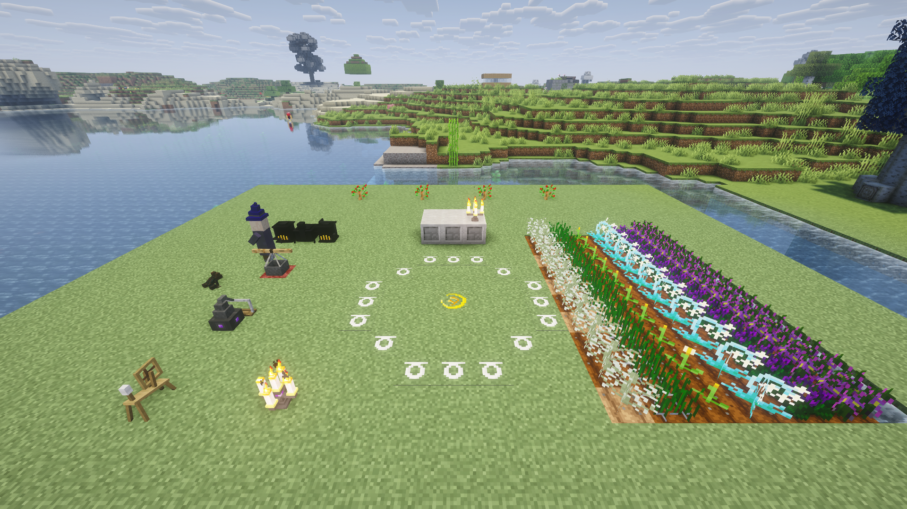<br><sub><b>Witchery (1.7.10)</b>: ritual circle, altar, witch's oven, kettle and crops, drawn by Witchery's own renderers</sub></td>
<td width="50%">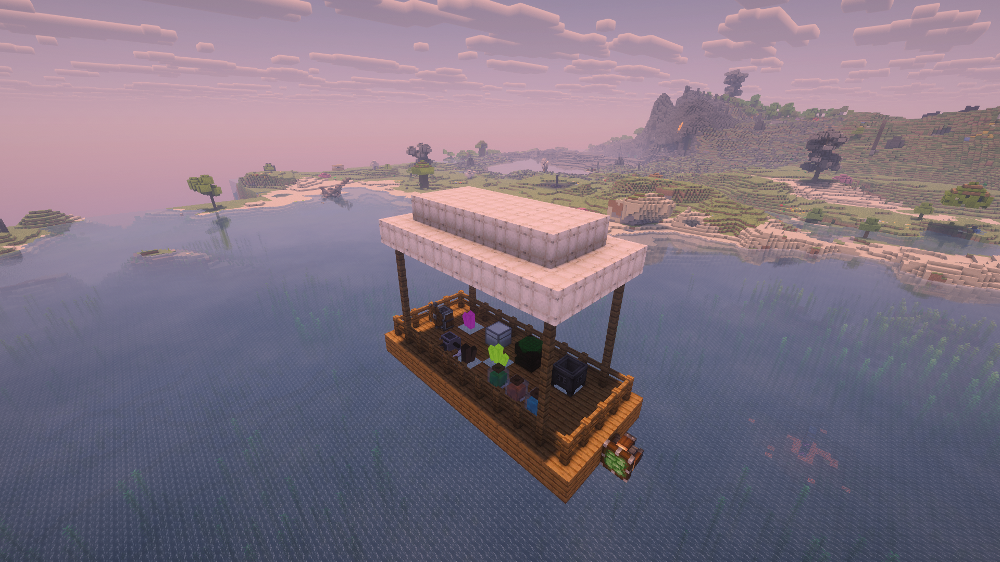<br><sub><b>Create Aeronautics + 1.7.10 blocks</b>: Thaumcraft jars, an Iron Chest, a RotaryCraft engine and ChromatiCraft crystals on a Sable airship</sub></td>
</tr>
<tr>
<td>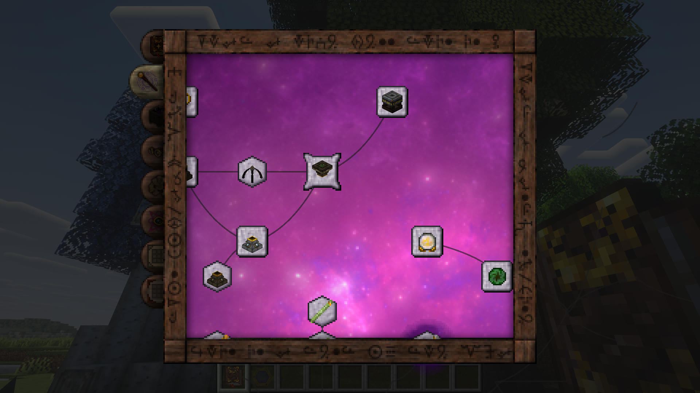<br><sub><b>Thaumcraft 4</b>: the Thaumonomicon, drawn by Thaumcraft's own font renderer and book code</sub></td>
<td>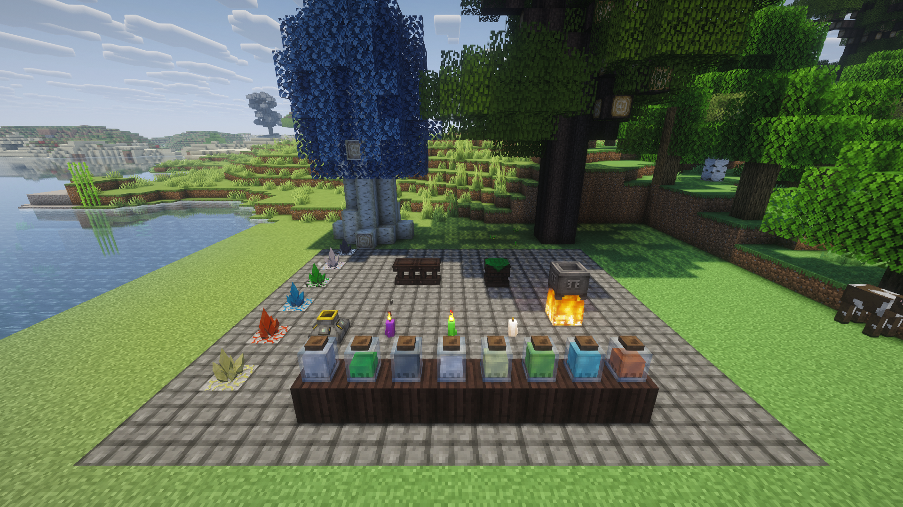<br><sub><b>Thaumcraft 4</b>: a workshop with infusion altar, crucible, alembics, essentia jars and an aura node</sub></td>
</tr>
<tr>
<td>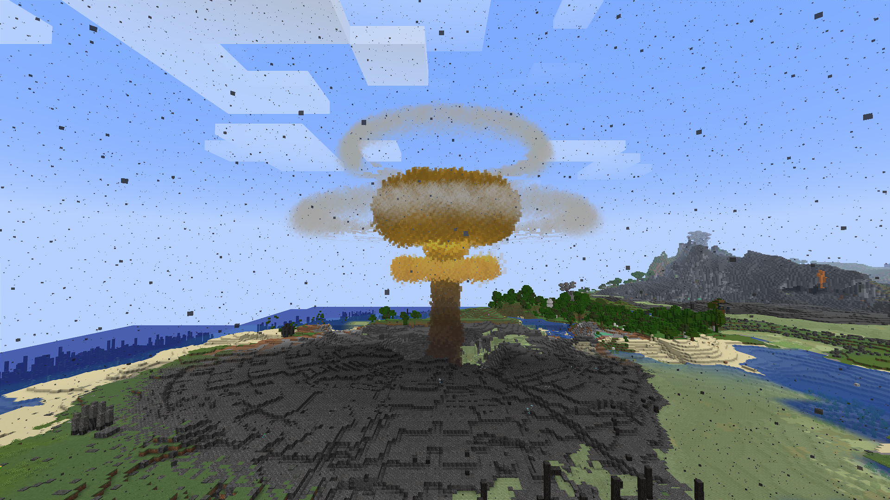<br><sub><b>HBM's Nuclear Tech (1.7.10)</b>: fireball, mushroom cloud and scorched crater from HBM's own effect code</sub></td>
<td>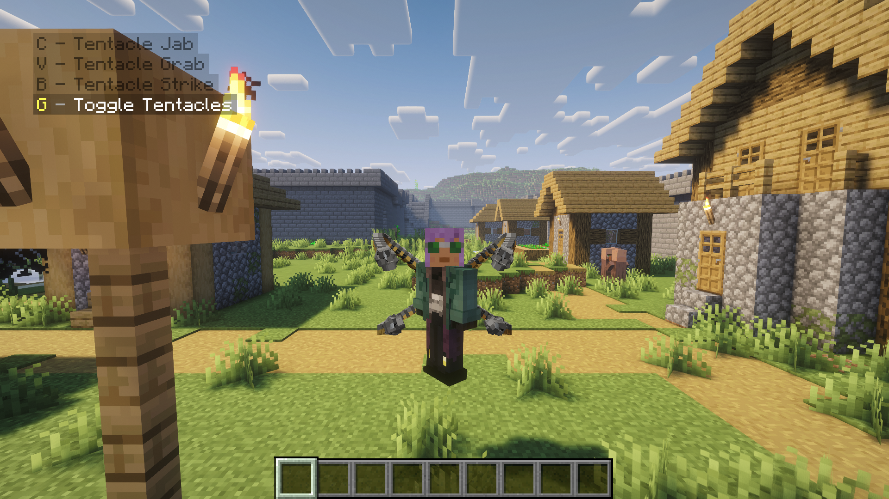<br><sub><b>Fisk's Superheroes (1.7.10)</b>: Doctor Octopus's suit, its abilities on Fisk's own HUD</sub></td>
</tr>
<tr>
<td>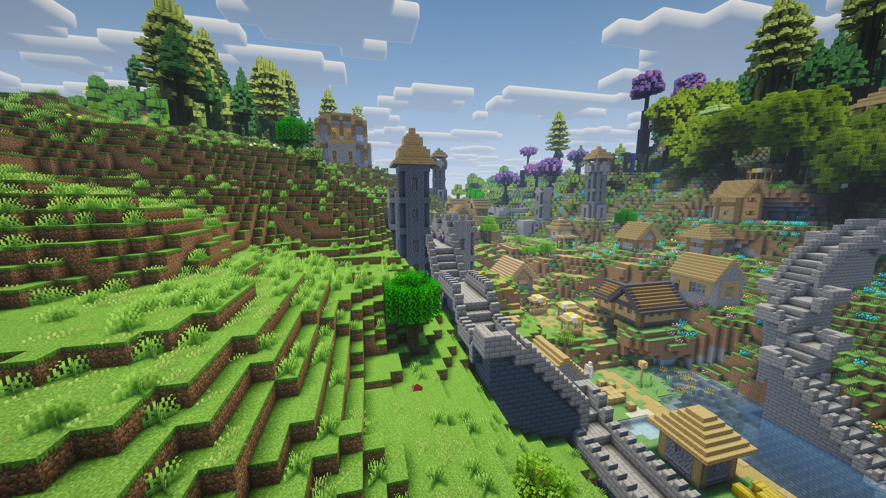<br><sub><b>Villages in All the Mods 10</b>: Witchery's town walls and Thaumcraft's wizard tower in a vanilla village</sub></td>
<td>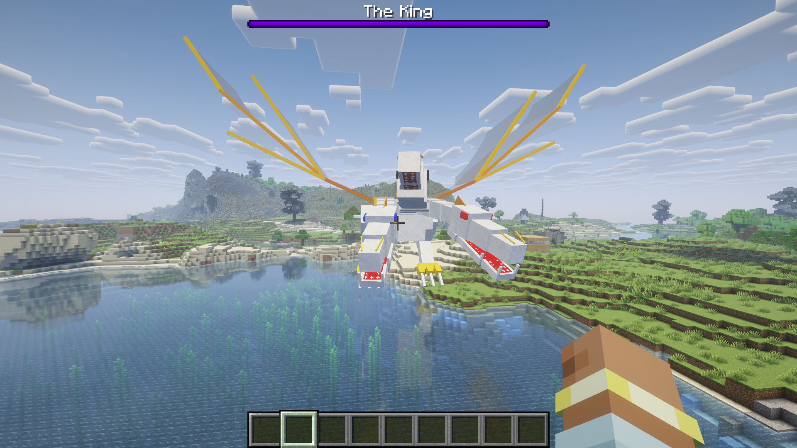<br><sub><b>OreSpawn (1.7.10)</b>: The King, with a modern boss bar</sub></td>
</tr>
<tr>
<td>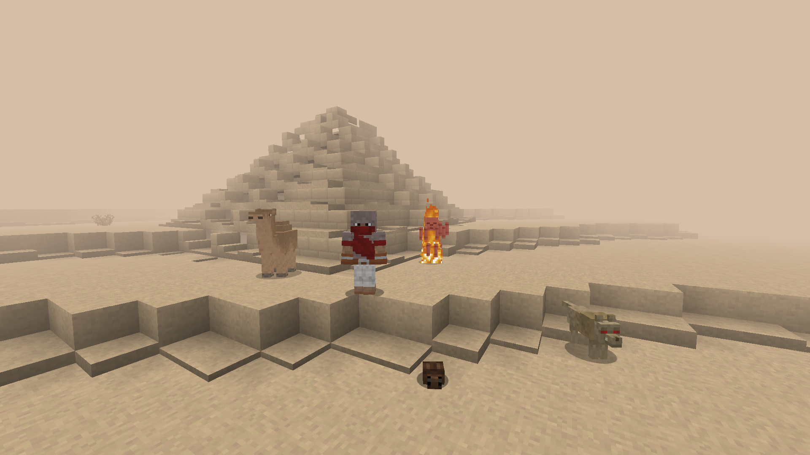<br><sub><b>Atum 2 (1.12.2)</b>: the desert dimension and its creatures, from Atum's own chunk generator</sub></td>
<td>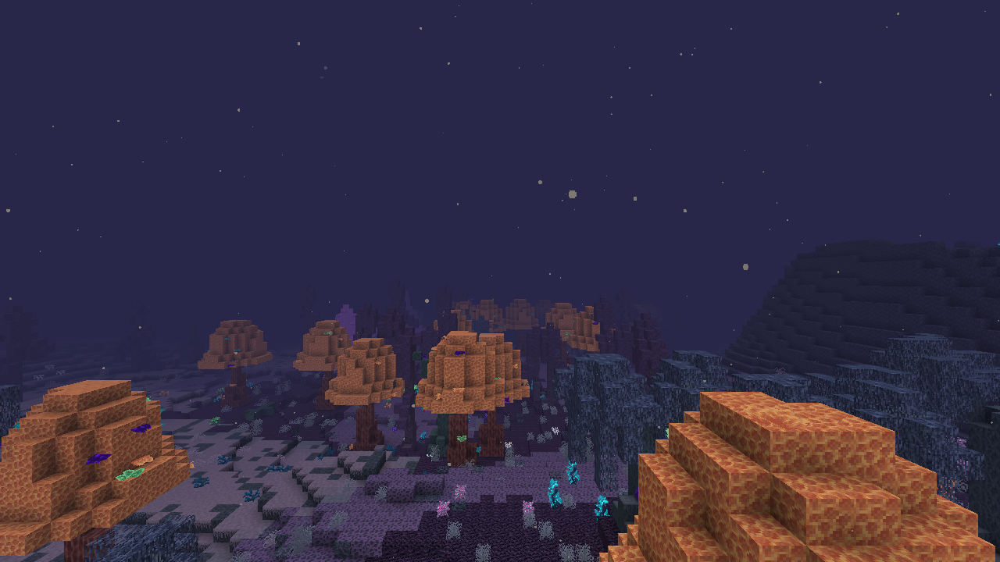<br><sub><b>The Midnight (1.12.2)</b>: the Deceitful Bog under the mod's night sky</sub></td>
</tr>
<tr>
<td>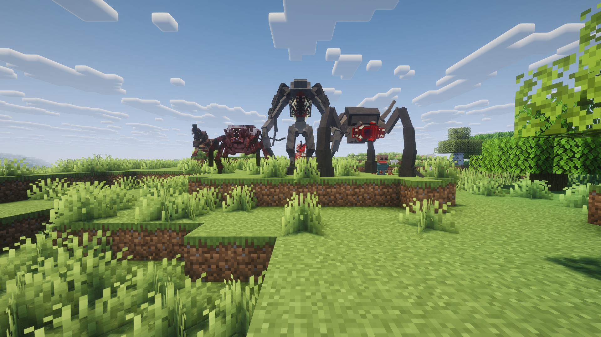<br><sub><b>Scape and Run: Parasites (1.12.2)</b>: parasites drawn by the mod's own renderers, Complementary shaders</sub></td>
<td>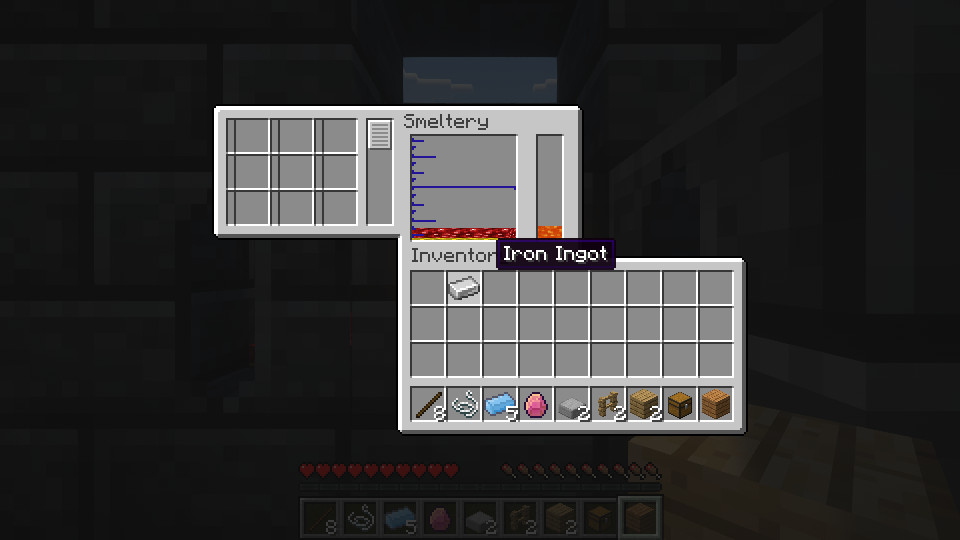<br><sub><b>Tinkers' Construct (1.6.4)</b>: the smeltery melting ore, in survival</sub></td>
</tr>
<tr>
<td>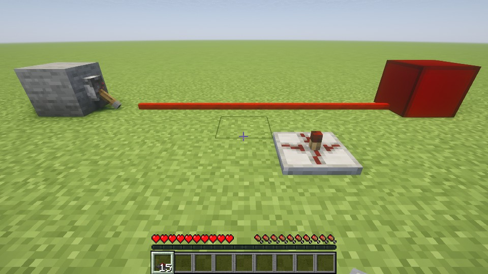<br><sub><b>RedPower 2 (1.4.7)</b>: lever, red alloy wire, NOT gate and lamp</sub></td>
<td>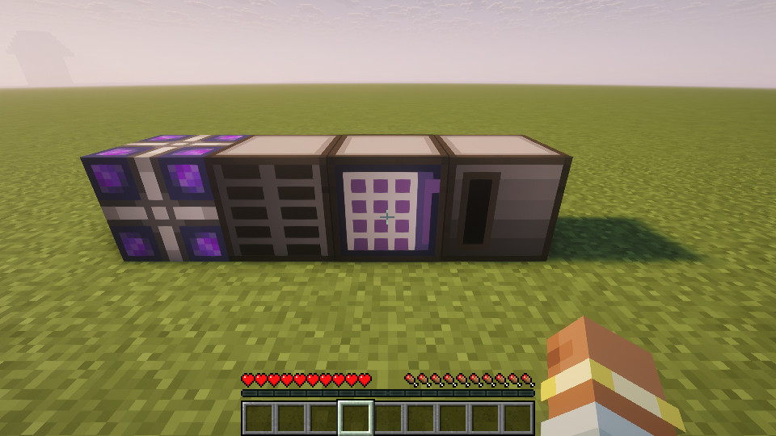<br><sub><b>Applied Energistics 1 (1.5.2)</b>: controller, terminal and drive</sub></td>
</tr>
</table>

## Building from source

You need JDK 21:

```sh
./gradlew bundleJar        # the distributable jar: build/dist/legacyconnector-<version>.jar
./gradlew build            # everything, with the checks
```

To contribute:
- Read [Development](docs/wiki/Development.md) (test tools, regression suites) and [`AGENTS.md`](AGENTS.md) (design rules and workflow).
- The [Architecture](docs/wiki/Architecture.md) page explains how the translation works.
- To write an addon for legacy mods, see the [Addon API](docs/wiki/Addon-API.md) (API 0.3, every supported version).

The full technical documentation starts at the [wiki home](docs/wiki/Home.md).

## Credits

- Beta 1.7.3 support: contributed and maintained by Zekken01.
- Palladium and its addon packs on Forge 1.20.1: contributed by kentvillamor08.
- Thanks to everyone who tests mods and reports what works on the [compatibility site](https://kylepitcock.github.io/Legacy-Connector/) and in the issues.

## Star history

[](https://star-history.com/#kylepitcock/Legacy-Connector&Date)

## License

Legacy Connector is released under the [MIT License](LICENSE).

**Modpacks:** anyone may include Legacy Connector in a modpack, on any platform, without asking for permission. This covers Legacy Connector
only; the legacy mods you put next to it keep their own licenses.

This project contains no Minecraft, Forge or third-party mod code. Do not commit or redistribute legacy mod jars; users supply their own.
Third-party libraries and the MIT-licensed portions adapted from Retromod are listed in [`THIRD_PARTY_NOTICES.md`](THIRD_PARTY_NOTICES.md).
