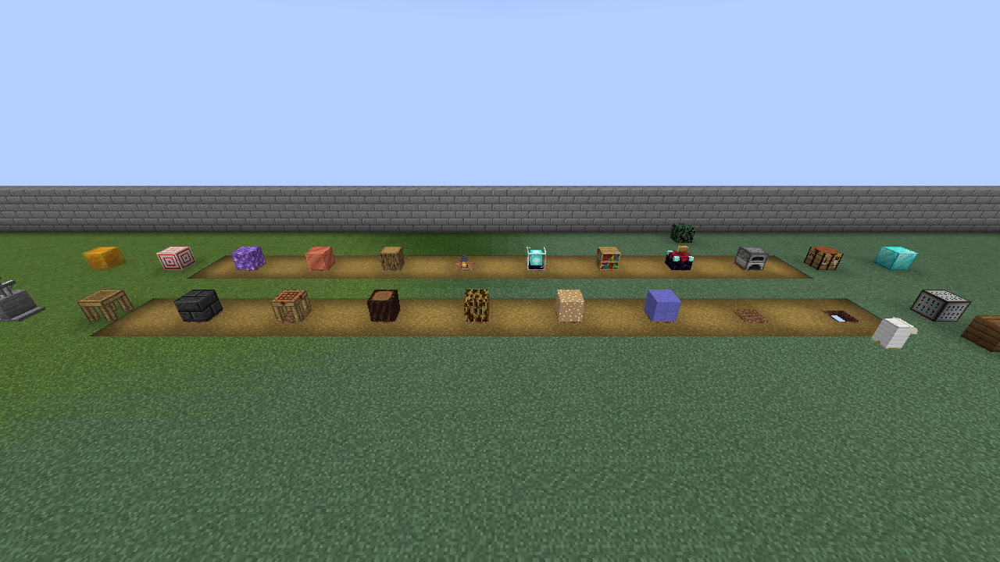
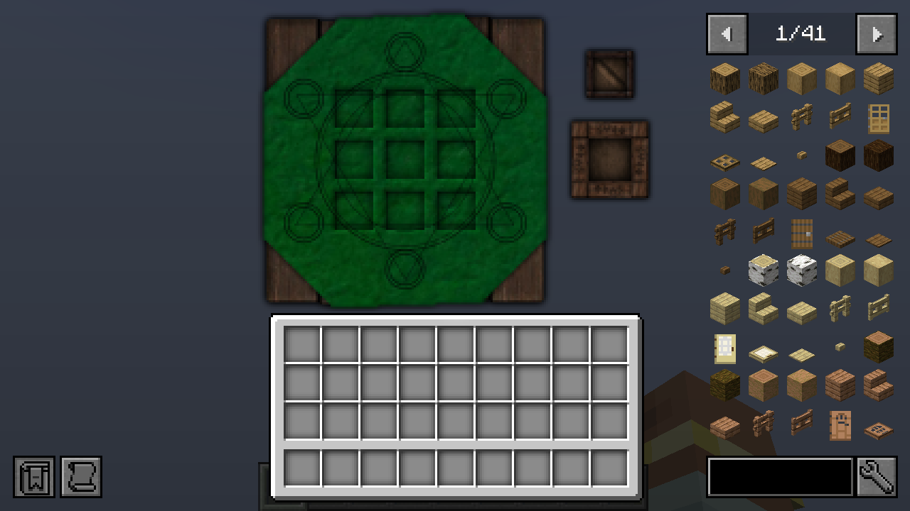
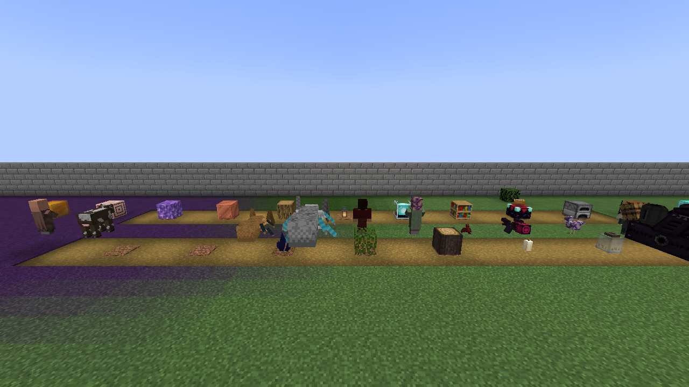
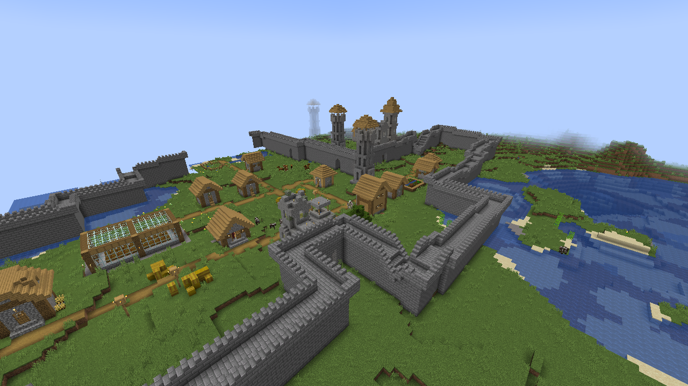

# Legacy Connector

[](https://www.curseforge.com/minecraft/mc-mods/legacy-connector) [](https://modrinth.com/mod/legacyconnector)

Run **unmodified legacy Forge mods on NeoForge 1.21.1**. Drop a 1.7.10 mod jar (1.12.2 mods are experimental, see the status table) into your `mods` folder next to
this mod; it is translated at load time, the same way [Sinytra Connector](https://github.com/Sinytra/Connector)
runs Fabric mods on NeoForge. The original jar is never modified.

> **Status: alpha (0.2.x).** 1.7.10 is the main target; 1.12.2 is experimental (loads and registers content, little verified in a real game; issue #64). Content mods (Iron Chest, AgriCraft, BiblioCraft, Botania, Biomes O'
> Plenty, HBM, Thaumcraft, Witchery and many more) load with their blocks, items, entities, recipes, GUIs,
> world generation and dimensions, and large tech packs load most of their mods; Galacticraft with its addons runs with per-planet gravity and silent space. Some features are still missing or
> unverified (see [Known compatibility issues](#known-compatibility-issues)), so back up your worlds.

**Compatibility list and reports: https://kylepitcock.github.io/Legacy-Connector/** (check a mod, or report how it worked for you).

## Screenshots

All taken in the game (NeoForge 1.21.1, headless), with legacy 1.7.10 mods next to modern content.

Blocks of Applied Energistics 2, Twilight Forest, Tinkers' Construct and BiblioCraft (front row) beside vanilla 1.21 blocks (back row):



Thaumcraft's Arcane Workbench, a block's own 1.7.10 GUI code drawn in 1.21 next to JEI:



Twilight Forest and Witchery entities beside a vanilla cow and villager:



A modern village with Witchery's watchtowers and AgriCraft's greenhouse built by their legacy code:



## How it works

```
mods/SomeMod-1.7.10.jar
        │  loader (FML locator service, runs before mod discovery)
        ▼
  1. Inspect      detect the legacy version (mcmod.info, @Mod, FML/Forge references)
  2. Translate    relocate Minecraft/Forge/FML classes into the shim namespace, SRG -> MCP names,
                  Java 8 -> 21 fixes (removed JDK APIs, reflection on final fields, Guava, LWJGL 2 -> 3)
  3. Link         every legacy API reference is resolved against, in order:
                    a. the hand-written shim   - legacy API re-implemented on top of NeoForge (real behaviour)
                    b. the synthesized API     - generated for whatever the shim lacks (links, default behaviour)
  4. Resources    lang files, textures and models converted to 1.21 formats
        ▼
.legacyconnector/cache/SomeMod-<hash>.jar  +  legacyconnector-synth-1.7.10-<hash>.jar  ->  loaded by NeoForge
        │  runtime (normal NeoForge mod)
        ▼
  Bridges         legacy registrations -> modern registries (blocks, items with metadata, tile entities,
                  recipes -> data pack, ore dictionary -> tags, GUIs -> menus/screens, networking, world gen, ...)
```

### Generic first, per-mod code only as a last resort

The layer is not written for specific mods. Mods are made to work by implementing the **legacy API** they
were written against:

- **Hand-written shim** (`src/main/java/legacyconnector/v1_7_10/...`): `Block`, `Item`, `ItemStack`, `World`, `Entity`,
  `GameRegistry`, `Container`, `GuiContainer`, `TileEntitySpecialRenderer`, `SimpleNetworkWrapper`, ... as views
  over the modern objects.
- **Synthesized API** (`loader/.../synth/`): any legacy class or member the shim does not implement yet is generated
  at load time from the legacy class hierarchy (shipped as `loader/src/main/resources/legacyconnector/legacy/<ver>/hierarchy.txt`)
  and the descriptors the mods use. Generated classes keep their real supertypes (a synthesized `BlockColored` *is*
  a `Block`), constructors chain to the closest real one, methods return safe defaults, and calls on hand-written
  classes for missing methods are dispatched to the mod's own override when it has one. This is what lets an
  arbitrary mod *load* instead of crashing with `NoClassDefFoundError`; the first call to each stub is logged so the
  most-used gaps can be implemented properly.

Mod-specific code is the exception: it is used only when no generic fix works, only for popular mods, and it is kept small
and isolated (today: the DragonAPI crafting/smelting hooks in `CoremodHooks`).

### Legacy loader behaviour that is reproduced

- FML `@Optional.Interface` / `@Optional.Method` stripping for absent mods, and removal of interfaces from APIs that
  exist nowhere (what some mods' own coremods did).
- Integrations with mods that are not installed: methods that need an absent API are replaced by a lazy
  `NoClassDefFoundError`, so the rest of the class still loads (the JVM verifies whole classes at once).
- Access transformers: the shim is public and non-final throughout, as mods compiled against AT-widened Minecraft.
- FML's Scala language adapter (`object` mods) and the libraries 1.7.10 shipped: Scala 2.11, Trove, vecmath.
- Coremods: their plugins are constructed and set up as FML did (construct all, then `getASMTransformerClass` /
  `injectData` / setup hook by sorting index; mod containers count as loaded mods). Their class transformers run over
  the legacy mod classes before translation, in a stand-in LaunchWrapper class loader with the legacy FML API, so
  coremods that patch *mod* classes work: CoFH `@Strippable`, AE2 `@Integration`, OpenMods, Steve's Addons, patcher
  mods fixing other mods' API mismatches. Transformers aimed at Minecraft's own classes find nothing to patch.
- LaunchWrapper's `Launch.blackboard` / `Launch.classLoader`.
- Resource URLs: mod jars are served from NeoForge's `union:` file system; mods that list their own jar's files
  (checking for `jar:`/`file:` URLs) get the equivalent `jar:file:` URL.
- Mods linking against each other's classes (e.g. RotaryCraft extends DragonAPI) are linked as one modset; APIs
  shaded into several jars are merged, preferring the copy from the mod that owns the API.

### Outdated dependencies

Libraries that were never updated are replaced by their modern equivalent instead of being loaded, when that mod is
installed (the same idea as Connector Extras bridging Trinkets to Curios):

| Legacy library | Modern replacement | Status |
|---|---|---|
| Baubles 1.0 (`baubles.api`) | [Curios](https://www.curseforge.com/minecraft/mc-mods/curios) | Baubles is skipped; `IBauble` items become curios in the ring/necklace/belt slots; `BaublesApi.getBaubles` reads the Curios slots. |
| NotEnoughItems (`codechicken.nei`) | [JEI](https://www.curseforge.com/minecraft/mc-mods/jei) | NEI is skipped; mods' `NEI*Config` plugins run; each legacy recipe handler becomes a JEI category over its own GUI texture; NEI-hidden items are hidden in JEI. |
| Waila (`mcp.mobius.waila.api`) | [Jade](https://www.curseforge.com/minecraft/mc-mods/jade) | Waila is skipped; legacy tooltip providers registered through Waila's IMC callback show their lines in Jade. |
| CoFH RF API (`cofh.api.energy`, shaded by most tech mods) | NeoForge Energy capability (built in) | Always on: RF tiles and items expose `IEnergyStorage` (1 RF = 1 FE), so modern cables and machines connect. |

Without the modern mod, the legacy library is translated and loaded as usual (except the RF API, which needs none).

Mods that only make sense on 1.7.10's engine or launcher (performance/bug-fix patches such as FastCraft or Hodgepodge,
ID extenders, LWJGL 3 ports) are not loaded; client mods (JourneyMap, Inventory Tweaks, ...) are;
`legacyconnector-report.txt` says why.

New bridges are declared in `loader/.../LibraryBridges.java` and implemented under the shim namespace.

### Bridges at a glance

Two kinds of bridge exist. *Library bridges* replace an outdated legacy library by its modern equivalent (the table
above); *engine bridges* map a legacy system onto the 1.21 one it corresponds to. Status for 1.7.10:

**Implemented**

| Bridge | Legacy side | Modern side |
|---|---|---|
| Baubles → Curios | `baubles.api` | Curios slots |
| NEI → JEI | `codechicken.nei` | JEI categories and hidden items |
| Waila → Jade | `mcp.mobius.waila.api` | Jade tooltips |
| CoFH RF → NeoForge Energy | `cofh.api.energy` | `IEnergyStorage` (1 RF = 1 FE) |
| Blocks and tile entities | `Block`, `TileEntity`, metadata | registered blocks and block entities, one per legacy block |
| Items and ItemStacks | `Item`, `ItemStack` damage/NBT | one item per metadata subtype, `CUSTOM_DATA` NBT |
| Recipes and smelting | `GameRegistry` / `CraftingManager` / `OreDictionary`, custom `IRecipe` classes (IC2, AE2, Blood Magic, Witchery ...) | data-pack recipes, tags; a custom recipe is a `legacyconnector:legacy_recipe` that matches and crafts through the legacy object |
| Entities | `Entity`, spawn/save/load, mob AI | entity types, spawns, saving |
| Fluids | Forge `Fluid` / containers | fluid types |
| Villagers | `VillagerRegistry` ids, skins, trade handlers | `legacyconnector:villager_<id>` professions, trades, clothes layer; some new unemployed villagers take them |
| GUIs and containers | `GuiHandler`, `Container` | menus and screens |
| Networking | FML `SimpleNetworkWrapper` / channels | NeoForge payloads |
| Commands | `ICommand`, server command manager | Brigadier |
| Dimension physics | `WorldProvider` gravity, fall damage and sound attenuation (Galacticraft's `IGalacticraftWorldProvider`) | gravity attribute, fall damage multiplier, client sound volume per dimension |
| Chest loot | `ChestGenHooks.addItem` for dungeon, mineshaft, pyramid, stronghold, village and bonus chests | an extra pool on the matching vanilla chest loot table |
| Biomes, world types, mod dimensions | `BiomeGenBase`, `GenLayer`, `WorldProvider` | data-driven biomes, `legacyconnector:dim_<id>` |
| World generation | `IWorldGenerator`, decorators | chunk generation hooks |
| Events | Forge/FML event buses | NeoForge event bus |
| Sounds, potions, creative tabs | `SoundHandler`, `Potion`, `CreativeTabs` | sound events, effects, tabs |
| Stats and achievements | `StatList`, `AchievementList` | local bookkeeping (counts not tracked yet) |
| Coremods that patch mods | `IClassTransformer` plugins | applied to mod classes before translation |
| Java 8 → 21 | reflection hacks, removed JDK classes | `ReflectionCompat`, `ResourceCompat`, JDK stand-ins |
| API drift between mods | a library method whose return type changed | relinked to the installed signature |

**In progress / partial**

| Bridge | State |
|---|---|
| Entity rendering, armour and held items | bridged (including the player renderer and its `RenderPlayerEvent`s, creeper and large chest models, flame and breaking particles), not verified in game for every mod |
| Block rendering (`ISimpleBlockRenderingHandler`, TESRs) | Handlers draw in the world (Tinkers' tables, AE2, AgriCraft crops), renderers can bind vanilla textures by their 1.7.10 names, blocks that colour themselves (leaves, grass, `colorMultiplier`) are biome tinted; per-vertex colour and ambient occlusion of handler-drawn blocks missing, some handlers (Tinkers' drying rack, barricades) still draw nothing |
| Dimension sky/fog/clouds | Implemented (see *Mod dimensions*); Twilight Forest's fog and Galacticraft's planets work, but the skies of other mods' dimensions are not all verified |
| Portal placement | Twilight Forest's portal works; other mods' portals are not verified |
| Statistics counting | stats exist for mods to register against; the modern stats are not driven by them |
| Coremods that patch Minecraft itself | cannot run on the shim; the common cases (DragonAPI's recipe list and smelting hook) are handled one by one |
| Mods built for a different version of another mod | only return-type drift is relinked (Binnie's mods against Forestry 4.2.16 still fail) |
| 1.12.2 bridges | experimental (server side only, see the status table and issue #64) |
| 1.20.1 (+ Sinytra), 1.16.5 bridges | planned, in that order |

### World generation

Legacy biomes (for example Biomes O' Plenty's) become real 1.21 biomes, generated as data (they also join the vanilla biome tags of the vanilla biome they are modelled on, so vanilla structures, mob spawns and biome modifiers apply to them): climate, colours, and the
ores, caves and small plants of the closest vanilla biome. Trees and grass come from the legacy biome itself: its
decorator runs the legacy passes (the biome's own tree and plant generators) and its extra features, gated by Forge's
terrain-gen events as on 1.7.10. Where legacy biomes appear is decided by the 1.7.10 biome layer system (`GenLayer`,
`WorldType`, Forge's `BiomeManager`), re-implemented in the shim, so a mod's own layer chain runs unmodified.
1.21 terrain, oceans, rivers, beaches, mountains and caves are kept; legacy biomes replace ordinary land biomes where
the legacy layers place them. Mods' `IWorldGenerator`s (ores, structures) run for every chunk.

A world type a mod registers (BoP's "BIOMESOP") appears on the Create World screen's world type button; on a
dedicated server use `level-type=<modid>:<type>` (e.g. `biomesoplenty:biomesop`). With the default type, mod biomes
that mods added to Forge's `BiomeManager` still generate.

### Mod dimensions

A dimension a legacy mod registers with `DimensionManager.registerDimension` becomes the modern dimension
`legacyconnector:dim_<id>`. Its chunk generator (`LegacyChunkGenerator`) runs the mod's `WorldProvider.createChunkGenerator()`:
terrain comes from `provideChunk` (block/metadata arrays), trees, structures and ores from `populate`. Biomes come from the
provider's own `WorldChunkManager` layers (`LegacyBiomeSource`), and `World.provider` is an instance of the mod's provider class.
`ServerConfigurationManager.transferPlayerToDimension` and `Teleporter` work as in 1.7.10. Verified with Twilight Forest's
terrain, portal and fog, and Galacticraft's planets (per-planet gravity, silent space). A dimension takes its fog colour, cloud height, sky/cloud/weather renderers and flat-world horizon from its legacy `WorldProvider`; legacy sky renderers that draw with unsupported GL fall back to the vanilla sky.

### Structures, fluids and input

`MapGenBase`, `MapGenStructure`, `StructureStart`, `StructureComponent` and `StructureBoundingBox` are ported, so mods'
dungeons, villages and ruins generate through their own legacy code (structure starts are recomputed from the seed rather
than persisted). Forge fluids (`BlockFluidClassic`/`Finite`, `ItemFluidContainer`) flow by scheduled ticks and are drawn
by a built-in renderer; every legacy `Fluid` also gets a modern fluid, and fluid tanks of legacy tiles and containers
are exposed as NeoForge `FluidHandler` capabilities. `Keyboard`, `Mouse` and `KeyBinding` read the modern window and
register with the controls screen. ForgeMultipart's runtime mixin compiler works (Scala signatures of translated classes are rewritten to the relocated names, and ASM 5's lenient descriptor parsing is kept). Shaders written for the fixed-function pipeline are virtual (they compile "successfully"
and have no effect); VBO and vertex-array calls are emulated on top of immediate mode.

### Entities

Each legacy entity class a mod registers (`EntityRegistry.registerModEntity` / `registerGlobalEntityID`) becomes a
modern entity type. Its instances are run by a host: a vanilla entity (`PathfinderMob` for living ones, an `Enemy`
monster for `IMob`s) that constructs the legacy object and forwards ticking, AI, damage, death and drops, sounds,
interaction, saving and spawn data to it. The legacy base classes (`Entity`, `EntityLivingBase`, `EntityLiving`,
`EntityCreature`, `EntityMob`, `EntityAgeable`, `EntityAnimal`, `EntityTameable`) are real implementations on top of
the host, so `super` calls compose as on 1.7.10: the legacy AI scheduler (`EntityAITasks`) runs the mod's tasks, the
vanilla AI tasks are backed by the equivalent modern goals, navigation and move/look/jump helpers drive the host's
own, `DataWatcher` values are synced to clients, legacy attributes map to modern ones, Forge's
`EntityConstructing` event and `IExtendedEntityProperties` work (also for players), and `addSpawn` entries become
biome modifiers.

On the client, renderers registered with `RenderingRegistry.registerEntityRenderingHandler` draw the entities: the
legacy `Render`/`RenderLiving` code runs inside a render context that maps its OpenGL matrix and state calls onto
the modern pose stack and buffers, legacy models (`ModelBase`, `ModelBiped`, `ModelQuadruped`, ...) emit real
geometry, and `Tessellator`/immediate-mode (`glBegin`) geometry is assembled into quads with the matching modern
render type (textured, translucent or additive). Biped renderers draw worn armour (vanilla layers or a mod's
`getArmorTexture`) as render passes and the held item through the modern item renderer.

### Block and item rendering

- **Textures:** `registerBlockIcons`/`registerIcons` run when the resource pack is generated; icon names become sprite
  ids (vanilla 1.7.10 names map through a rename table to the 1.21 names). `TextureMap`/`TextureAtlasSprite` are real:
  sprites a mod builds itself with a custom loader (Railcraft's unstitched sheets, HBM's recoloured textures) are run
  at pack generation and written out as ordinary textures.
- **Blocks:** the generated block models cover cubes, partial blocks, plants, crops and stairs. Blocks drawn by an
  `ISimpleBlockRenderingHandler` get a model that runs the handler while the chunk is meshed: the Tessellator
  captures its quads (`RenderBlocks` implements the face renderers) and they become the block's baked quads.
  Tile entity special renderers (`TileEntitySpecialRenderer`) run in the render context like entity renderers.
- **Items:** Forge `IItemRenderer`s and 3D `ISimpleBlockRenderingHandler` inventory renders draw through a
  `builtin/entity` model. `AdvancedModelLoader` loads Wavefront OBJ models for renderers.
- **Vanilla behaviour constants** (render types, opacity of the vanilla block classes) come from a table generated
  from the 1.7.10 jar (`tools/extract_block_constants.sh`), since the vanilla classes are shells.
- Not yet: per-vertex colour and ambient occlusion of handler-drawn blocks, `IIcon`s of non-block atlases.

## Configuration

Settings live in `config/legacyconnector.properties`, written with defaults and comments on first start.

| Key | Default | Effect |
| --- | --- | --- |
| `oreBackgrounds.enabled` | `true` | Replace the old stone/netherrack/end stone behind legacy ore textures |
| `oreBackgrounds.stone`, `.netherrack`, `.endStone` | `stone`, `netherrack`, `end_stone` | Vanilla block texture used instead (e.g. `deepslate`, `tuff`), or `legacy` to keep the old rock |
| `deepLayer.enabled` | `true` | Run legacy world generators a second time so ores also spawn below y=0 |
| `deepLayer.excludeGenerators` | empty | Comma separated generator class prefixes that must not run below y=0 |

Ores (full blocks whose name has `ore` as a word) get a hidden `<name>_deepslate` twin automatically: the same legacy block (drops, hardness, behaviour) with its stone background replaced by deepslate. Where a generator places an ore into deepslate (the deep layer, and the deepslate band just above y=0) the twin is placed instead. Ores with tile entities are not duplicated. The ore texture of the normal block can also sit on a deepslate background (`oreBackgrounds.stone=deepslate`).

## Compatibility status

| Legacy version | Status |
|---|---|
| 1.7.10 | **Alpha.** Iron Chest, Twilight Forest, Thaumcraft, HBM, RFTools, Thermal Expansion and others work in game; Galacticraft with its addons runs with per-planet gravity. In the latest startup test of the 230-mod GTNH pack, 282 mods across the corpus load without errors and 52 fail during loading (see the [compatibility list](https://kylepitcock.github.io/Legacy-Connector/)). Mod biomes, world types and dimensions generate; mod entities spawn, tick, fight and save; entity rendering (including the player renderer), armour and held items, dimension fog/sky and Twilight Forest's portal are bridged, though not verified in game for every mod. All synthesized API classes pass JVM verification. |
| 1.12.2 | **Experimental (loads and registers content; rendering and gameplay mostly unverified; issue #64).** Implemented: the FML lifecycle, registry events (blocks, items, potions, enchantments, sounds, biomes, entities, recipes, villager professions, custom registries made with `RegistryBuilder`), items with subtypes, blocks and block states (one `meta` property mapped through `getStateFromMeta`/`getMetaFromState`), tile entities with client sync, capabilities (items, fluids, energy), networking channels, recipes (code recipes become data pack recipes), ore dictionary, tools/armor, fluid data model, `@ObjectHolder`, `@SidedProxy`, `@EventBusSubscriber`, coremod plugins and vanilla constants (`Blocks`, `Items`, ...). Mod blockstates, item models (`ModelLoader`) and model/texture names renamed after 1.12 are translated, but the client has only been smoke-tested (about 1750 model warnings across Botania, Chisel, AE2 and Immersive Engineering in the last client run). Server tests: of 32 big jars (EnderIO, Mekanism, Thermal, BuildCraft, AE2, Botania, Blood Magic, Tinkers, Forestry, Thaumcraft, Twilight Forest, BoP, ...) 1 of 50 mod ids still fails (BuildCraft Silicon) and about 2060 blocks, 3480 items and 3670 recipes register (`@Config` classes are filled from their config files; vanilla items with metadata map to their flattened modern items); of 39 more jars (Roots, Vampirism, Totemic, RFTools, Pam's HarvestCraft, The Betweenlands, Ice and Fire, TechReborn, ...) 16 of 42 mod ids fail, some from missing dependency jars. Blockstates in Forge's v1 format (defaults, per-variant textures) and code-defined state mappers are translated, and blocks and their items show in a client for Chisel's marble and Botania; many models still show as missing. Missing: entities and AI, containers and GUIs, in-world fluids, world generation, custom `IRecipe` classes and most client rendering. Results per mod are on the compatibility site. Performance, bug-fix and mixin-loader mods (FoamFix, BetterFPS, VanillaFix, ...) are skipped. |
| 1.16.5 | Planned. |
| 1.20.1 (Forge + Fabric via Sinytra Connector) | Planned. |

Not supported (and likely never fully): coremod transformers and mixins that patch legacy Minecraft code itself,
LaunchWrapper tweakers. They are reported, and the rest of the mod still loads. Where a coremod only exists to change
engine behaviour that has a modern equivalent, the layer bridges the behaviour instead (Galacticraft's gravity and
silent space are applied per dimension, see *Dimension physics* above).

### Known compatibility issues

Found by loading a ~140-mod 1.7.10 test pack (`test-mods/`) together. Everything not listed here loaded in the last
full run; "loads" does not mean every feature was played through.

| Mod / combination | Issue | What to do |
|---|---|---|
| RotaryCraft (with DragonAPI) and Forestry 4.2.16 | DragonAPI's wood list asks Forestry for blocks named `planks2` and `slabs1`-`slabs4`, which Forestry 4.2.16 does not register (it has `planks` and `slabs`); the list then holds a null block and RotaryCraft is disabled at post-init. The same names broke Binnie's pre14. DragonAPI and ReactorCraft load. | Use a Forestry/DragonAPI pair built for each other (no matching 1.7.10 Forestry build was found on Modrinth). |
| Binnie's Mods 2.0-pre14 with Forestry 4.2.16 | Binnie was built for an older Forestry API (`getProducts`, `getLogStacks`, `planks2` do not exist in 4.2.16); ExtraBees, Botany, BinnieCore and ExtraTrees fail, and anything that runs their recipes (ThermalExpansion) with them. | Use Binnie's Mods 2.0.22.7 (loads); Binnie Patcher is then not needed. |
| Witchery + RotaryCraft | Both default to potion id 35; DragonAPI refuses to start. | Change `Freeze Potion ID` in `config/Reika/RotaryCraft.cfg` (or Witchery's id). |
| ProjectRed Expansion + Runic Dungeons | Both use enchantment id 80. 1.7.10 crashed; here one enchantment is moved to a free id and a warning is logged. | Change an id in the mods' configs to keep ids stable. |
| Mystcraft + NetherOres | NetherOres swaps the vanilla quartz ore block through CoFH registry reflection. Works, because replaced vanilla blocks keep the vanilla identity. | None. |
| Mods that patch Minecraft's own classes with coremods | The patches cannot run on the shim classes. Only DragonAPI's crafting-list and smelting hooks are provided (`CoremodHooks`); other such patches do nothing. | Report the mod. |
| Railcraft and EnderIO anvils | `ContainerRepair` is implemented with the vanilla field names and rules; not yet checked in game. | Test in game. |
| HBM's pylons/substations, RFTools screens, Thermal Expansion tanks and caches, Runic Dungeons portal | Fail in the automated block self test, which uses a fake player and no tile state; not confirmed in real play. | Test in game. |
| Decocraft | Loads through a stand-in for the JDK-internal PNG reader; models not checked in game. | Test in game. |
| Tinkers' Construct and other mods whose `getSubItems` reads client-only icon arrays | Subtype discovery registers icons against a detached register; blocks whose arrays still stay empty get metadata 0 only until used. | None. |
| Villager professions, trades and village components (`VillagerRegistry`) | Modded professions with skins and trade handlers appear on some new unemployed villagers (they have no job site). Village creation handlers (Witchery's shops, walls, towers; AgriCraft's greenhouses) build their components inside modern villages: each chunk plans them from the seed in the village's bounding box, free of the jigsaw pieces. They do not connect to the village paths, and the vanilla piece factories mods call (`House1.func_74898_a` ...) return nothing. | Not fixed. |
| Brewing stand, fishing loot | `PotionHelper` and `FishingHooks` exist for legacy code that calls them, but modern brewing and fishing loot tables do not use them, so mod potions and mod catches are not added. Achievement pages are recorded but not shown (1.21 has advancements). | Not fixed. |
| `/locate structure` | Vanilla structures are found in legacy biomes (they join the vanilla biome tags). Structures drawn by legacy generators are found with `/locate structure legacyconnector:<name>` (the generator's name, lower case), among visited chunks only. | Not fixed. |
| Tinkers' Construct materials on modern Tinkers | Not bridged: the real modern Tinkers' Construct exists only for 1.20.1, not NeoForge 1.21.1 (planned with the 1.20.1 target). | None. |
| JourneyMap / Custom Main Menu / Inventory Tweaks (1.7.10 versions) | Loaded like any other legacy mod. Custom Main Menu replaces the title screen (`GuiOpenEvent`/`GuiScreenEvent` are bridged; its panorama, logo and splash draw, buttons are being verified). The other two are not verified. | Report what you see. |
| FastCraft, Hodgepodge, NEID and other engine/launcher patches | Intentionally not loaded (see above). | Use their modern equivalents. |

### What happens to a mod

After launching, read **`logs/legacyconnector-report.txt`**. For every legacy jar it lists the detected version and mod
ids, references that could not be linked, and which legacy APIs were synthesized (they link but do nothing yet).
At runtime, `LegacyConnector/Stubs` log lines show which synthesized APIs are actually called.

## Development

Requires JDK 21.

```sh
./gradlew build                 # runtime mod + loader (also builds the distributable jar)
./gradlew bundleJar             # single distributable jar: build/dist/legacyconnector-<ver>.jar, the ONLY jar for a mods folder
                                # (build/libs/*-runtime-only.jar has no loader: every legacy mod is then rejected as built for an old Minecraft)
./gradlew runClient             # dev client, mods from run/mods
./gradlew runServerTest         # headless smoke test with run-servertest/mods; the fixture mod self-tests and stops
LEVELTYPE=biomesoplenty:biomesop tools/dev/run-subset.sh biomesoplenty   # same, in a mod's world type
tools/dev/run-subset.sh hbm thaumcraft     # server test over a few mods only, with the
                                # block/item/entity self tests; the whole corpus takes minutes
./gradlew runClientTest         # client smoke test (run-clienttest, mods linked from run/mods): reports per mod
                                # which models show the missing texture, then quits
tools/dev/run-screenshot-test.sh agricraft appliedenergistics   # graphical test: creates a world (WORLDTYPE=biomesoplenty:biomesop
                                # for BoP), builds block/item showcases, writes screenshots to run-screenshots/shots
SCENARIO=village tools/dev/run-screenshot-test.sh witchery agricraft   # flies over the nearest village (legacy village components)
SCENARIO=gui MODS=rftools tools/dev/run-screenshot-test.sh rftools mcjtylib   # right-clicks each block of the mods and
                                # screenshots the screens that open (custom GUIs); SCENARIO=portal tests a Twilight Forest portal
tools/dev/docker-headless.sh run-screenshot-test.sh ...        # same, inside a Linux container with a virtual display
                                # (Xvfb + Mesa; needs `colima start`), so no window opens on the desktop;
                                # also works for run-client-test.sh
tools/dev/session.sh start <jar fragments>   # one long-lived headless client you drive without restarting it:
tools/dev/session.sh send cmd "legacyconnector dim 7"   # run a command / open GUIs / `mouse x y` / `click x y` / `useitem` / `inv` / `info` ...
tools/dev/session.sh shot name                 # screenshot -> ~/.cache/legacyconnector-docker/work/run-screenshots/control/out/name.png
tools/dev/survey.sh <namespace> <name>         # places every block of a mod on a sky platform and screenshots it
./gradlew checkLegacyMod -PlegacyJar=/path/a.jar,/path/b.jar   # e.g. every jar in test-mods/
                                # translate offline as one modset, list unlinkable references,
                                # generate + JVM-verify the synthesized API (no game launch)
```

Development commands (operator, any world): `/legacyconnector mods` lists the loaded legacy mods;
`/legacyconnector dim list|<id> [pos]` switches to a legacy dimension; `/legacyconnector gui <mod> <id> [pos]` opens a mod
GUI by its `IGuiHandler` id; `/legacyconnector place <block> [meta]`, `give <item> [meta] [count]` and `spawn <entity> [count]`
create legacy content with metadata; `/legacyconnector list <blocks|items|entities> <mod>` prints a mod's ids; `/legacyconnector biome <id>` jumps to a legacy biome; `/legacyconnector inspect`
describes the block or entity you look at (legacy class, metadata, tile entity, render type). Ids tab-complete.

Project layout:

| Path | What |
|---|---|
| `loader/` | FML locator service: jar inspection, translation, linking, API synthesis, caching, report |
| `src/main/java/legacyconnector/v1_7_10/` | 1.7.10 shim (legacy package names, relocated) |
| `src/main/java/org/kylepitcock/legacyconnector/` | runtime: bootstrap, bridges to NeoForge, JDK/library compat, synth runtime |
| `testmods/` | fixture mod compiled against legacy API stubs, built like a real 2014 jar |
| `tools/` | developer scripts: reference data download, signature/hierarchy extraction, API lookup, shim hierarchy audit |
| `tools/docker/`, `tools/dev/` | headless-display container image; dev test scripts (subset server test, client/screenshot tests) |
| `test-mods/` | (not committed) local corpus of real legacy mods for `checkLegacyMod` / `runServerTest` |

Reference data (MCP mappings, Forge userdev sources, Mojang client jars) is downloaded into `build/devtools/` by
`tools/fetch_devtools.sh` and the extraction scripts; none of it is committed. Only class names and supertypes
(`hierarchy.txt`) and MCP name tables are shipped.

To regenerate the 1.7.10 hierarchy data:

```sh
tools/fetch_devtools.sh
python3 tools/extract_legacy_signatures.py 1.7.10   # needs build/devtools/mojang/client-1.7.10.jar
python3 tools/extract_legacy_hierarchy.py 1.7.10
```

## Legal

Legacy Connector is released under the [MIT License](LICENSE).

This project contains no Minecraft, Forge or third-party mod code. Do not commit or redistribute legacy mod jars;
users supply their own.
