<p align="center"></p>

# Legacy Connector

[](https://discord.gg/vC6x4Kwwdq) [](https://www.curseforge.com/minecraft/mc-mods/legacy-connector) [](https://modrinth.com/mod/legacyconnector) [](https://ko-fi.com/kylepitcock)

Run **unmodified legacy Forge mods on NeoForge 1.21.1**. Drop mods built for Minecraft 1.7.10, 1.12.2, 1.6.4, 1.5.2, 1.4.7, Forge 1.20.1 or
Beta 1.7.3 into the folder of their version next to this mod. They are translated when the game loads and run as normal NeoForge mods, the
same way [Sinytra Connector](https://github.com/Sinytra/Connector) runs Fabric mods on NeoForge. The original jars are never modified. The
point is mods that **only exist on these old versions** and never got a 1.21.1 port. Legacy content enters the game through the hooks a
modern mod uses (biomes, placed features, loot tables, village pools, capabilities, data packs), so it works with the pack's other mods and
data packs can tune it. Maturity differs per version, see the table below; back up your worlds before trying a new mod set.

**Compatibility list and reports: https://kylepitcock.github.io/Legacy-Connector/** (check a mod, or report how it worked for you).
Screenshots of legacy mods running on 1.21.1 are at the [end of this page](#screenshots).

## Status

"Probe" is the offline link check of release 0.4.14 (2026-11-13): jars whose references all resolve, out of the jars probed. It is not the
same as "works in play"; per-mod results are on the compatibility site. Details and the figures of the nightly build:
[Compatibility and status](docs/wiki/Compatibility-and-Status.md).

| Legacy version | Folder | Maturity | What is known to work | Probe |
|---|---|---|---|---|
| 1.7.10 | `mods/1.7.10/` | **Beta** (the most complete) | Thaumcraft 4, Witchery, HBM's Nuclear Tech, the Reika mods, OreSpawn, Fisk's Superheroes, Morph and Galacticraft with its addons run with blocks, items, entities, GUIs, world generation and dimensions; GT New Horizons loads most of its mods | 528 of 611 |
| 1.12.2 | `mods/1.12.2/` | **Beta** (since 2026-11-07) | Atum 2, The Midnight, The Betweenlands, Scape and Run: Parasites and Abyssalcraft load and play in a real client; mod fluids are real fluids with buckets | 578 of 645 |
| 1.6.4 | `mods/1.6.4/` | **Beta** (since 2026-11-08) | A layer over the 1.7.10 one; Tinkers' Construct (smeltery included), Mo' Creatures, Twilight Forest and Forestry were played in survival | 35 of 45 |
| 1.5.2 | `mods/1.5.2/` | Alpha | Twilight Forest, Applied Energistics 1, BuildCraft, ComputerCraft and Forestry run in a real client | 35 of 38 |
| 1.4.7 | `mods/1.4.7/` | Alpha | RedPower 2, BuildCraft, ComputerCraft and Applied Energistics run in a real client | 45 of 49 |
| Forge 1.20.1 | `mods/1.20.1/` | Alpha (on by default, `experimental.forge1201=false` turns it off) | Remapped in place onto 1.21.1; Terramity, Palladium with its addon packs (contributed by kentvillamor08) and Another Furniture run, most other mods still have unresolved references | 99 of 494 (nightly: 152) |
| Beta 1.7.3 | `mods/b1.7.3/` (jars or zips) | Alpha | ModLoader and Forge 1.0 era mods (contributed by Zekken01): blocks, items, recipes, tile entities, GUIs and supported mob families; entities and world generation are still incomplete | 38 of 44, 20 of them through placeholder APIs |
| 1.19.2, 1.18.2, 1.16.5 | | Planned | A chain of stages on top of the 1.20.1 pipeline ([plan](docs/wiki/Legacy-1.16-1.19-Plan.md)); 1.2.5 comes later | |

Not planned: 1.8 to 1.11.2 and the Alpha/early-Beta jar-mod era. Order and reasons: [Version roadmap](docs/wiki/Version-Roadmap.md); how the
work is organised: [Work plan](docs/wiki/Work-Plan.md). Missing features and known problems: [Compatibility and status](docs/wiki/Compatibility-and-Status.md#known-compatibility-issues).

Recent changes: on 1.12.2, modern containers and items are visible to old mods (pipes of an old mod can use a modern barrel), legacy
containers are capabilities for modern mods, and blocks drawn by a mod's own renderer through CodeChickenLib work (Thermal Dynamics ducts).
On 1.20.1, mixins whose targets changed are repaired or dropped one by one instead of failing the mod, raw network channels deliver, item
NBT in recipes and loot becomes data components, and a missing required dependency is shown on NeoForge's warnings screen. The
[addon API](docs/wiki/Addon-API.md) 0.3 covers every supported version.

## Install

1. Install NeoForge 21.1.x for Minecraft 1.21.1 (Java 21) and put Legacy Connector into `mods/`.
2. Put the legacy mods and the libraries they need (CodeChickenLib, CoFH Core, ...) for the same Minecraft version into the folder of that version:

   ```
   mods/
     legacyconnector-<version>.jar
     1.7.10/   1.12.2/   1.6.4/   1.5.2/   1.4.7/   1.20.1/   b1.7.3/
   ```

   Jars you drop into `mods/` itself are moved there on launch (`legacy.autoSortMods=false` turns that off).
3. Start the game. The first launch translates each legacy jar (progress bar on the loading screen) and caches the result, so later launches are fast.
4. Read `logs/legacyconnector-report.txt`: for every jar it lists what was detected, which references could not be linked and which APIs were synthesized.

Two caveats ([Troubleshooting](docs/wiki/Troubleshooting.md)):

- Jars that bundle their own Mixin (common in 1.12.2: Spartan Weaponry, MixinBooter mods) must be in their version folder before the first launch. In `mods/` NeoForge loads them as launcher plugins before they can be translated, and the game stops with "Module ... contains package org.spongepowered...".
- NeoForge rejects some file names before any mod runs, so such a jar is not sorted for you: a version part that starts with a dot, for example `HBM-NTM-.1.0.27_X5863.jar`. Put it into its version folder by hand or rename it.

A dedicated server works the same way; client-only mods are skipped there. If a legacy mod needs a library that is not installed, NeoForge's
"Warnings while loading mods" screen names the mod, the dependency and the folder to put it in; the mod is still loaded.

## Downloads

Tested releases are on [Modrinth](https://modrinth.com/mod/legacyconnector), [CurseForge](https://www.curseforge.com/minecraft/mc-mods/legacy-connector)
and [GitHub](https://github.com/kylepitcock/Legacy-Connector/releases/latest); they come less often and collect more changes. Every push to
`master` is also built automatically and published as the [Nightly release](https://github.com/kylepitcock/Legacy-Connector/releases/tag/nightly)
(one pre-release, replaced each time; the version is in the jar name). Use it to get a fix before the next release. It is untested: back up
your world, and name the nightly version when you report a problem.

## Libraries and dependencies

TerraBlender (legacy biomes are a TerraBlender region) and Pehkui (entity size) are embedded in the jar; a separately installed newer one wins.
Outdated libraries are bridged to modern equivalents instead of being loaded: Baubles to Curios, Waila to Jade, NEI to JEI, Patchouli books
to Patchouli, and CoFH RF / Redstone Flux to NeoForge energy; each bridge can be switched off (`bridges.<name>.enabled`). Legacy tile entities
and items are NeoForge item, fluid and energy capabilities by default (RF and Forge Energy, IC2 EU, BuildCraft MJ), so hoppers, Create and
modern cables work with them. Mods that only patch the old engine (performance patches, ID extenders) are skipped on purpose. Details:
[Bridges](docs/wiki/Bridges.md), [capabilities](docs/wiki/Addon-API.md#capabilities).

## Configuration

Settings live in `config/legacyconnector.properties`, written with defaults and comments on first start (also editable in game under
Mods, Legacy Connector, Config). The important ones:

| Key | Default | Effect |
| --- | --- | --- |
| `legacy.autoSortMods` | `true` | Move legacy jars dropped into `mods/` into the folder of their Minecraft version on launch |
| `mods.skip` | empty | Comma separated legacy mod ids to leave out entirely (read at startup) |
| `bridges.<name>.enabled` | `true` | `baubles`, `waila`, `nei`, `cofhEnergy`, `patchouli`: `false` loads the legacy library instead of its modern replacement |
| `experimental.forge1201` | `true` | Load Forge 1.20.1 mods (remapped in place); `false` leaves such jars alone |
| `experimental.forge1201.softlink` | `true` | A reference to a 1.21.1 class or member that no longer exists becomes a stand-in that throws only when it runs, instead of keeping the mod from loading |
| `legacy.deepWorld1122` | `true` | 1.12.2 mods can read and change blocks below y=0 down to the modern world bottom; `false` restores the 1.12 floor at y=0 for a mod that fails on negative y |
| `warnings.riskyMods` | `true` | Show one loading warning for translated mods that may not work fully ([details](docs/wiki/Troubleshooting.md)) |
| `oreBackgrounds.enabled` | `true` | Replace the old stone/netherrack/end stone behind legacy ore textures |
| `oreBackgrounds.stone`, `.netherrack`, `.endStone` | `stone`, `netherrack`, `end_stone` | Vanilla block texture used instead (e.g. `deepslate`, `tuff`), or `legacy` to keep the old rock |
| `modernizeTextures` | `true` | Replace old vanilla art inside legacy mod textures with the modern vanilla textures (exact copies of old block, item and GUI textures, and old backgrounds mods painted their art on; the mod's own art stays) |
| `textures.modernLeaves` | `true` | Rebuild legacy leaf textures that recolour the old vanilla leaves in the modern leaf pattern, in the mod's colours |
| `deepLayer.enabled` | `true` | Spread legacy ores down to the bottom of the world (below y=0) without adding any: the total per chunk stays the original mod's |
| `deepLayer.excludeGenerators` | empty | Comma separated generator class prefixes that must not run below y=0 |
| `blocks.flattenSubtypes` | `true` | Each legacy block subtype that has its own item becomes its own block (`mod:name_3`), as in the 1.13 flattening |
| `villages.legacyBuildings` | `true` | Legacy mods' village buildings join the vanilla village pools; `false` leaves villages vanilla |
| `legacyBiomeFrequency` | `1.0` | Scales how much land legacy mod biomes take in the overworld (`0` none in new chunks) |
| `events.skip` | empty | Legacy event handlers to leave unregistered (`full.ClassName#method`), for tracking down a handler that misbehaves |

All keys (energy conversion rates, `perf.*` switches, ...) are on the [Configuration](docs/wiki/Configuration.md) page.

## Troubleshooting

- Read `logs/legacyconnector-report.txt` after a launch: per jar, what was detected, unresolved references and synthesized APIs.
- NeoForge's "Warnings while loading mods" screen lists missing dependencies of legacy mods and, once per mod set, the translated mods that may not work fully.
- Start-up errors about Mixin modules or rejected file names, and join failures: [Troubleshooting](docs/wiki/Troubleshooting.md).
- To report a problem, open a [GitHub issue](https://github.com/kylepitcock/Legacy-Connector/issues) and attach `logs/latest.log` and `logs/legacyconnector-report.txt` as files (and the crash report if there is one). Say the Legacy Connector version (for a nightly, the full version), the mod and its Minecraft version, and what you did. Crash reports of a translated mod belong here, not with the mod's author. There is also a [Discord](https://discord.gg/vC6x4Kwwdq).

## FAQ

**What does it do?** It runs mods that were built for older Minecraft versions (Forge 1.4.7, 1.5.2, 1.6.4, 1.7.10, 1.12.2, 1.20.1, and ModLoader-era Beta 1.7.3) on NeoForge 1.21.1, next to modern mods. Legacy jars are translated when the game loads; the original file is never modified.

**How is it different from Retromod and Retrofit?** They are different tools. These summaries come from their own project pages, so check those for the details.
- [Retromod](https://modrinth.com/mod/retromod) (MIT) also rewrites old mods' bytecode when the game loads. It supports Forge, NeoForge, Fabric and Quilt, and its pages recommend it for content, quality-of-life, and library mods, not for mods that hook deep into the game (Create, Tinkers, Applied Energistics, and similar). Some MIT-licensed portions of Retromod are adapted in this project (see [`THIRD_PARTY_NOTICES.md`](THIRD_PARTY_NOTICES.md)).
- [Retrofit](https://github.com/Astryxx/Retrofit) (Astryxx) is an interoperability mod: it lets 1.7.10 and 1.20.1 mods work together (energy systems such as RF and IC2, ore dictionary, and tags). It does not load old mods onto a modern game.
- Legacy Connector is for NeoForge 1.21.1 only. For each old version it provides the old game's API itself (the engine, ids, world generation, packets, and rendering of the old blocks and items), so mods that use the game's internals can run: Thaumcraft, BuildCraft, Thermal Expansion, RedPower, and many more. It bridges outdated libraries to modern equivalents and exposes legacy containers as NeoForge capabilities.

**Will mod X work?** Check the compatibility site, then `logs/legacyconnector-report.txt` after a launch. Mods that only patch the old engine (performance patches, id extenders) are skipped on purpose, and coremods that patch Minecraft's own classes are not supported (Better Than Wolves and other patched-`minecraft.jar` mods cannot work).

**Does it work on a dedicated server?** Yes. Legacy mods run on a dedicated server too; client-only mods are skipped there.

**Does it work on Fabric or Forge?** No. It is a NeoForge 1.21.1 mod. (Fabric mods on NeoForge are what Sinytra Connector does; Legacy Connector is the equivalent for old Forge versions.)

## Documentation

Technical documentation is in [`docs/wiki`](docs/wiki/Home.md) (start at [Home](docs/wiki/Home.md)):
[Architecture](docs/wiki/Architecture.md), [Cache and redistribution](docs/wiki/Cache-and-Redistribution.md), [Bridges](docs/wiki/Bridges.md),
[Library candidates](docs/wiki/Library-Candidates.md), [World generation](docs/wiki/World-Generation.md),
[Mod dimensions](docs/wiki/Mod-Dimensions.md), [Entities](docs/wiki/Entities.md), [Rendering](docs/wiki/Rendering.md),
[Create and Sable](docs/wiki/Create-and-Sable.md), [Changing legacy recipes](docs/wiki/Recipes.md),
[Configuration](docs/wiki/Configuration.md), [Performance](docs/wiki/Performance.md), [Troubleshooting](docs/wiki/Troubleshooting.md),
[Compatibility and status](docs/wiki/Compatibility-and-Status.md), [Gameplay test log](docs/wiki/Gameplay-Test-Log.md),
[Development](docs/wiki/Development.md), [Version roadmap](docs/wiki/Version-Roadmap.md), [Work plan](docs/wiki/Work-Plan.md) and
[Plan for 1.19.2, 1.18.2 and 1.16.5](docs/wiki/Legacy-1.16-1.19-Plan.md). Per version: the estimate and corpus pages
([1.4.7](docs/wiki/Legacy-1.4.7-Estimate.md), [1.5.2](docs/wiki/Legacy-1.5.2-Estimate.md), [1.6.4](docs/wiki/Legacy-1.6.4-Estimate.md),
[1.20.1](docs/wiki/Legacy-1.20.1-Estimate.md), [Beta 1.7.3](docs/wiki/Legacy-b1.7.3.md)). Per-mod results are on the
[compatibility site](https://kylepitcock.github.io/Legacy-Connector/).

## Writing addons for legacy mods

Addons for legacy mods (a mod that registers content for, or hooks into, a translated legacy mod of any supported version) are described in
[Addon API](docs/wiki/Addon-API.md): API 0.3, with a support matrix per version.

## Screenshots

All taken in a real game client (NeoForge 1.21.1) with unmodified legacy mods that have no modern version, running next to modern content. The older versions (1.6.4, 1.5.2, 1.4.7) have their own [screenshot gallery](docs/screenshots/old-versions/README.md); a few of them are at the end of this section.

A Thaumcraft 4 workshop: infusion altar with items on its pedestals, crucible over lava, alchemical furnace with alembics, essentia
jars, arcane workbench, research table, an aura node over a stabiliser, infused stones with crystal clusters, and greatwood and
silverwood trees grown by Thaumcraft's own generators:

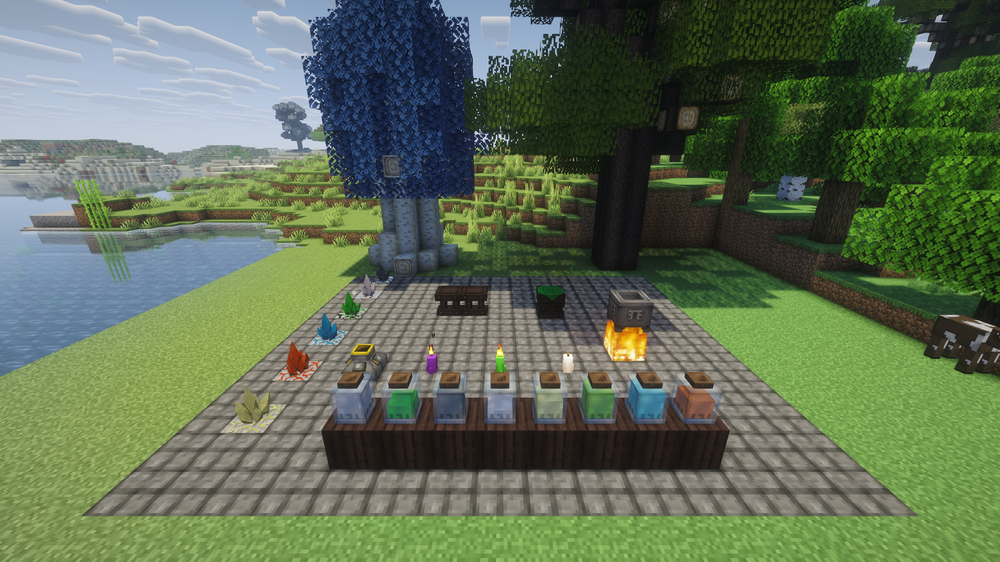

**A Create Aeronautics airship (Sable physics) carrying 1.7.10 blocks: Thaumcraft essentia jars, crucible and arcane workbench, an Iron Chest, a RotaryCraft engine, and ChromatiCraft crystals**

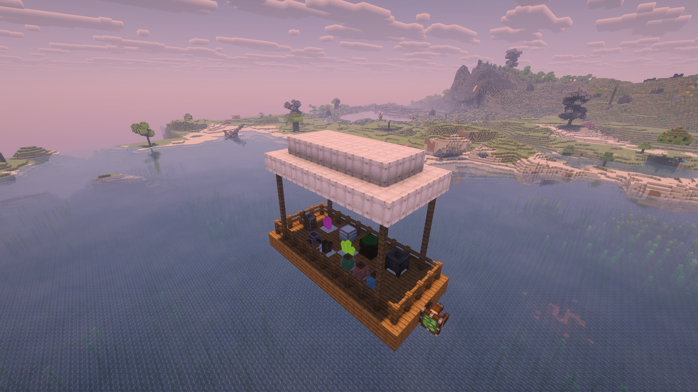

The Thaumonomicon, drawn by Thaumcraft's own font renderer and book code, and the Thaumometer held in both hands after scanning
stone (the Terra aspect in its lens, research points gained in the corner):

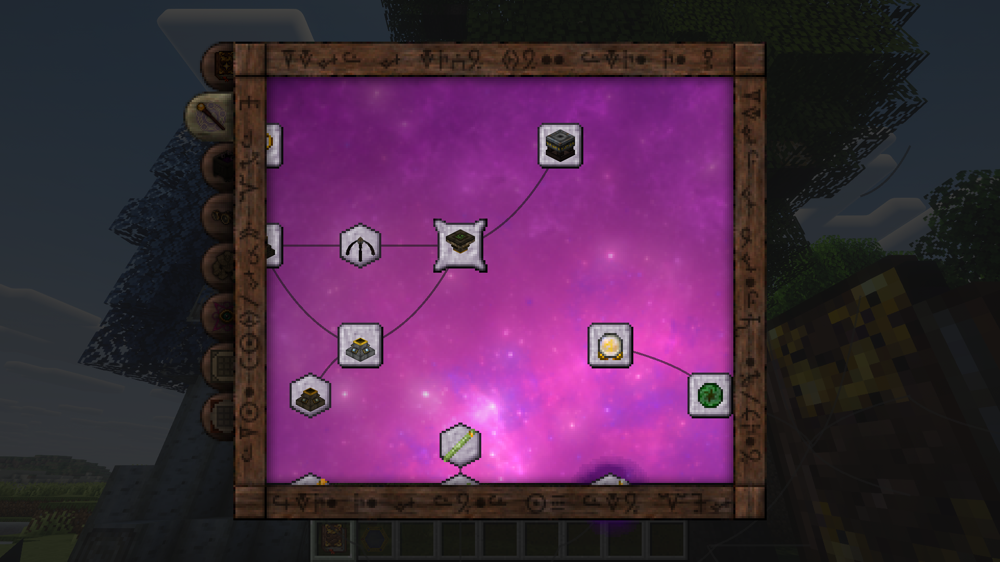

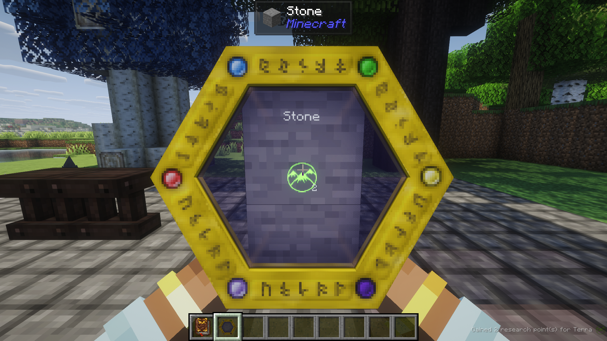

A Witchery ritual site: chalk ritual circle around a heart glyph, candelabras, the altar with a chalice and crystal ball, a witch's
oven with its fume funnel, kettle, distillery, and spinning wheel (all drawn by Witchery's own tile entity renderers), a crop patch of
belladonna, mandrake, snowbell, wolfsbane, garlic, and wormwood, rowan saplings, a coven witch, a mandrake, and a toad:

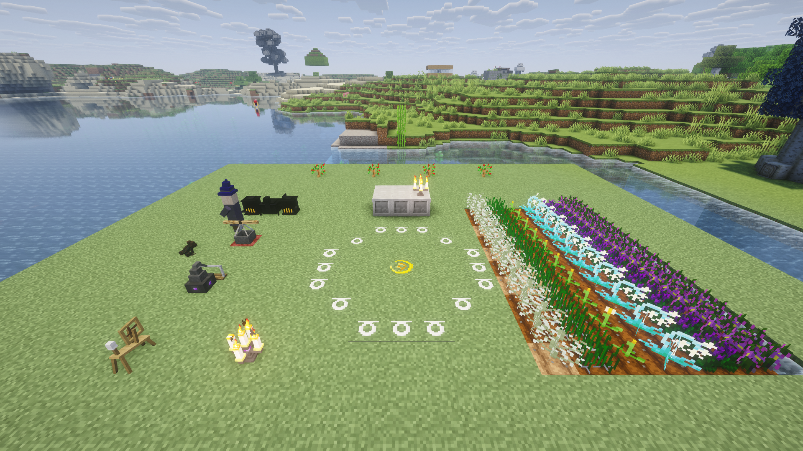

Fisk's Superheroes: Doctor Octopus's suit with its tentacles deployed, and the suit's abilities (tentacle jab, grab, and strike) on
Fisk's own HUD:

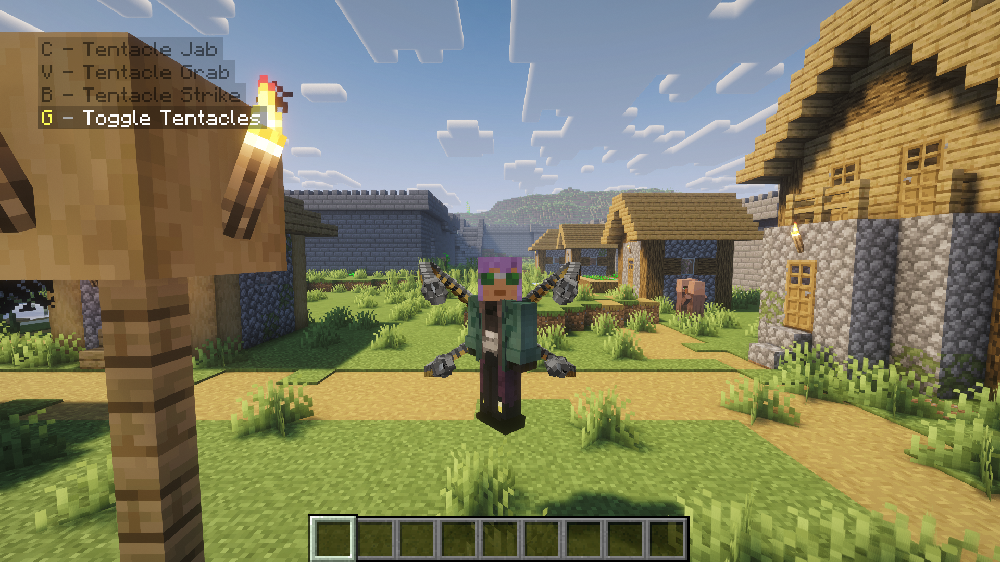

OreSpawn's The King on the plains, with a modern boss bar (OreSpawn itself shows its bosses' health only while you aim at them from 16 blocks or closer):

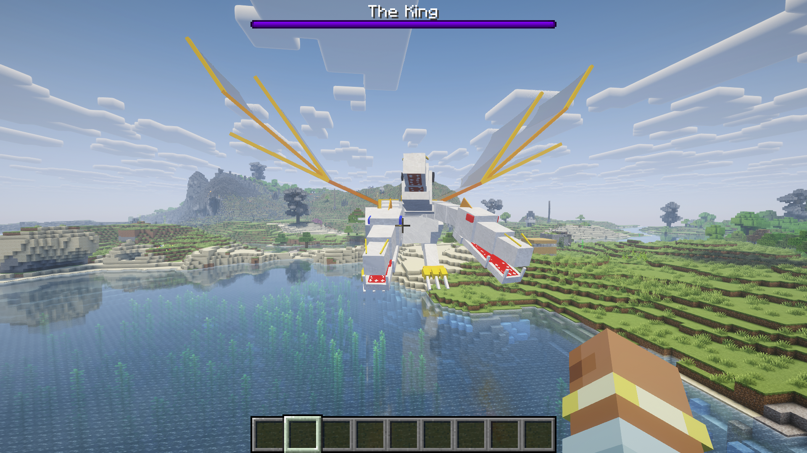

A vanilla village in All the Mods 10 (Complementary shaders) with the buildings 1.7.10 mods add to villages: Witchery's town walls,
keep and watchtowers and Thaumcraft's wizard tower, all built by their legacy village code beside modern mods' trees and terrain:

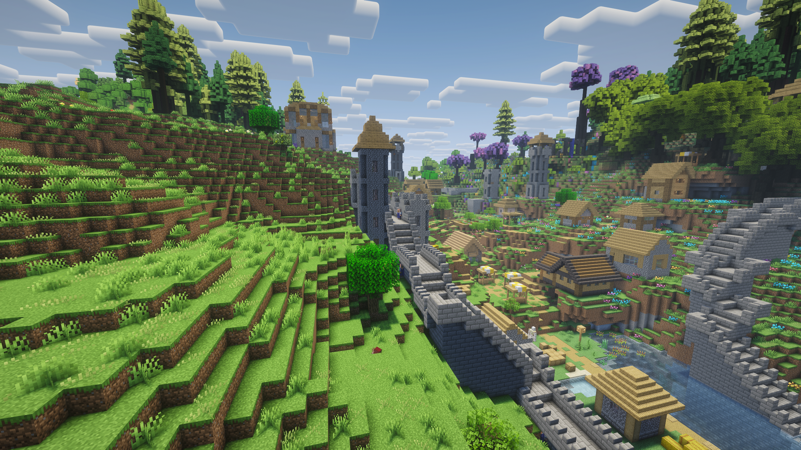

A nuclear explosion from HBM's Nuclear Tech Mod: the fireball and mushroom cloud with its condensation rings, flying debris, the
fallout-tinted sky and the scorched crater, all from HBM's own explosion and effect code:

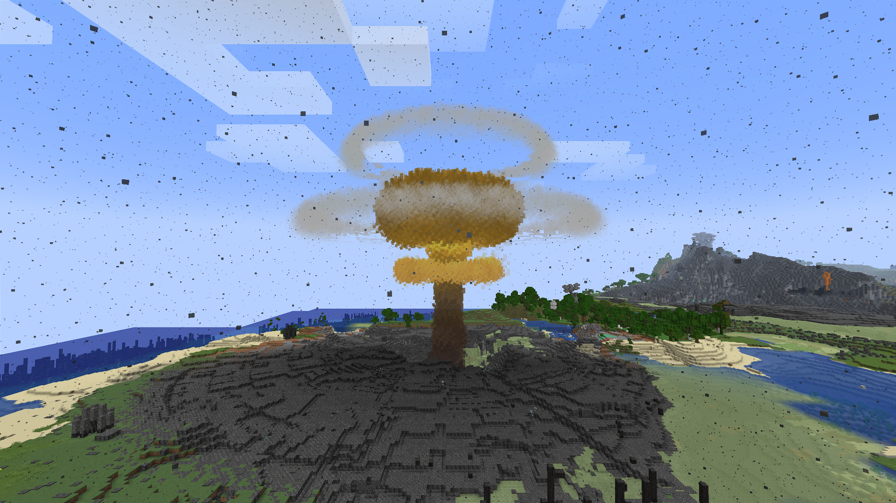

1.12.2: Atum 2, the desert dimension, generated by Atum's own chunk generator with its biomes, sandstorm haze, and sky colour:
Atum's creatures (camel, nomad, a mummy burning in daylight, bonestorm, desert wolf, and scarab) by a sandstone pyramid:

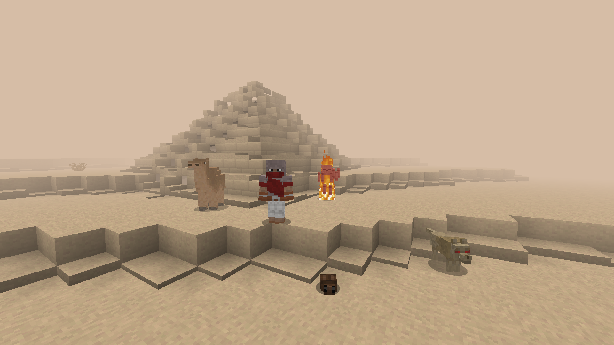

1.12.2: Scape and Run: Parasites. Primitive and adapted parasites (longarms, summoner, manducater, viscera, buglin, an infected human, bear, and golem),
drawn by the mod's own renderers under Complementary shaders:

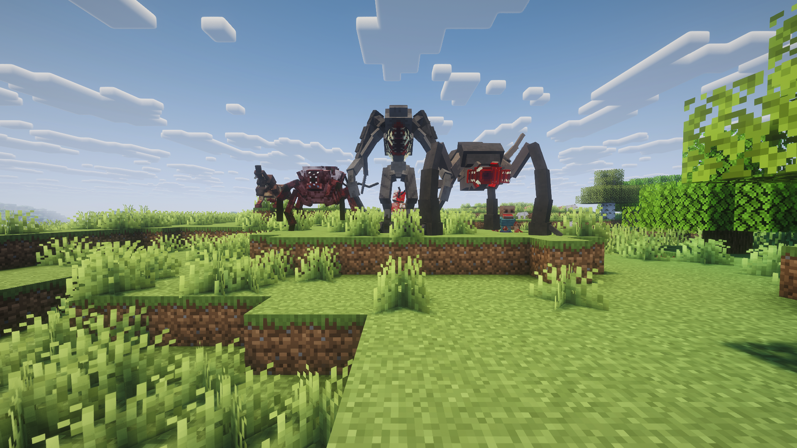

1.12.2: The Midnight, its own dimension: the Deceitful Bog with giant Bogshrooms, Nightstone ground, glowing plants, and the mod's night sky,
generated by the mod's own chunk generator and biomes:

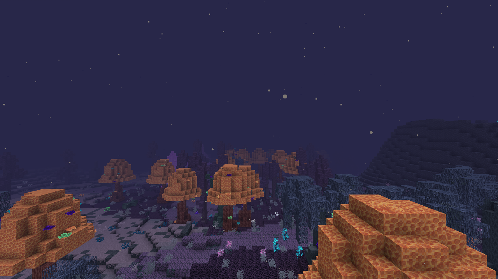

Older versions (alpha), taken with shaders in survival. 1.4.7: RedPower 2 logic, a lever, a red alloy wire, a NOT gate, and a lamp, and a ComputerCraft computer with its terminal:

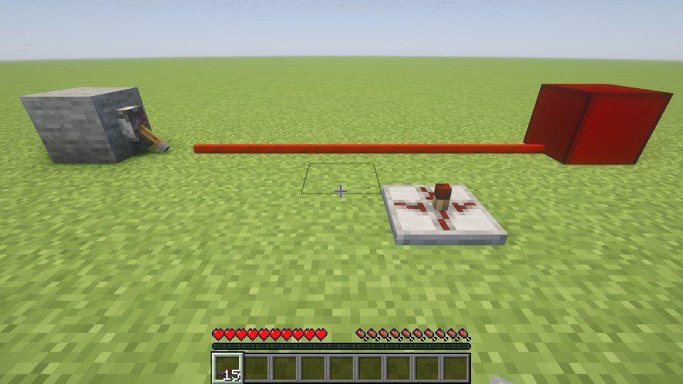

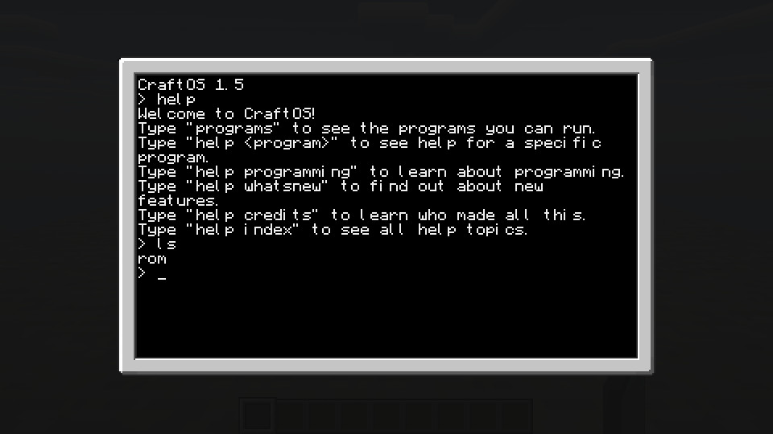

1.6.4: Tinkers' Construct's smeltery melting ore into molten metal, and Mo' Creatures' ostrich and elephant:

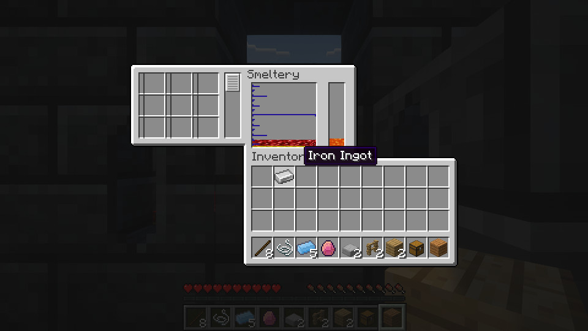

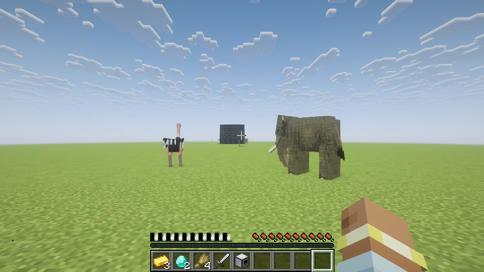

1.5.2: Applied Energistics 1's controller, terminal, and drive:

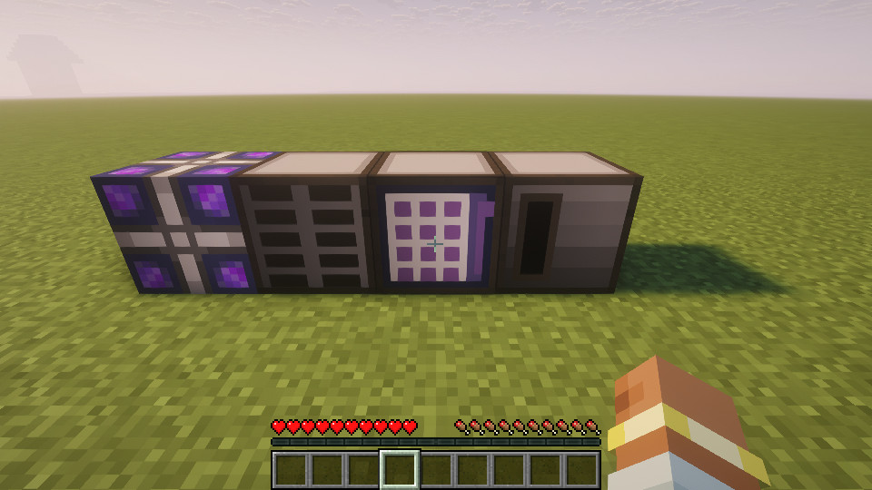

## Star history

[](https://star-history.com/#kylepitcock/Legacy-Connector&Date)

## Legal

Legacy Connector is released under the [MIT License](LICENSE).

**Modpacks:** anyone may include Legacy Connector in a modpack, on any platform, without asking for permission. This covers
Legacy Connector only; the legacy mods you put next to it keep their own licenses.

This project contains no Minecraft, Forge, or third-party mod code. Do not commit or redistribute legacy mod jars;
users supply their own. Third-party libraries and the MIT-licensed portions adapted from Retromod are listed in
[`THIRD_PARTY_NOTICES.md`](THIRD_PARTY_NOTICES.md).
