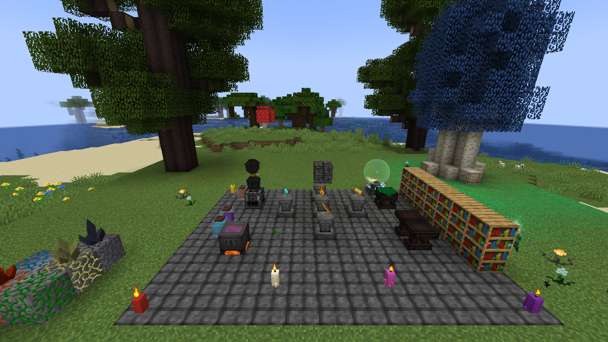
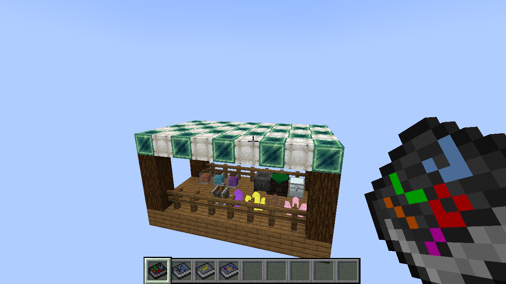
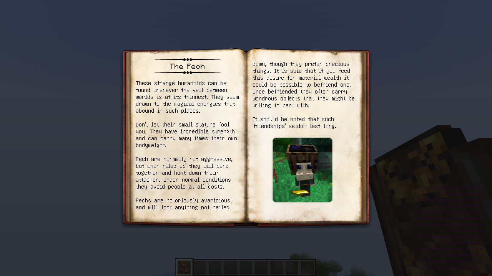
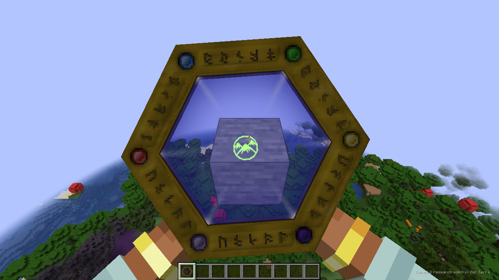
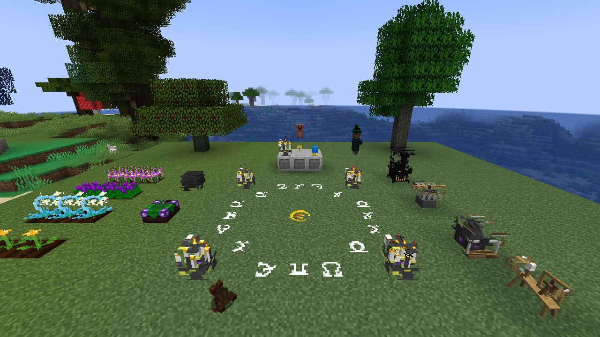
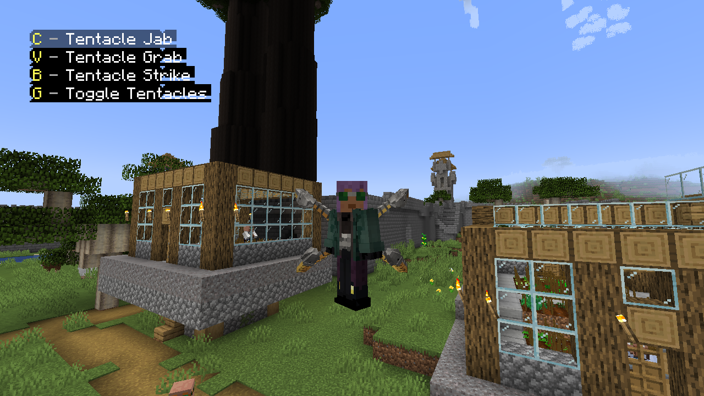
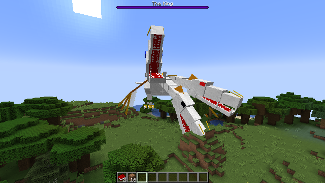
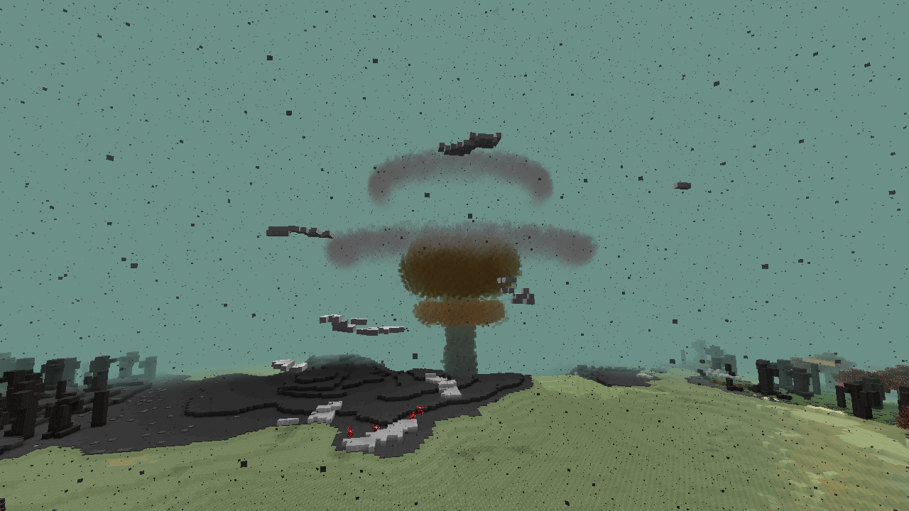
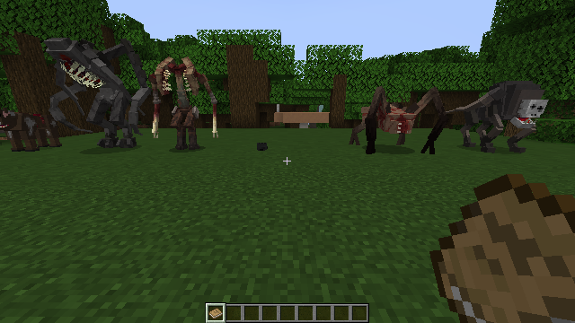

# Legacy Connector

 

Run **unmodified legacy Forge mods on NeoForge 1.21.1**. Drop 1.7.10 or 1.12.2 mod jars into your `mods` folder next to
this mod; it is translated at load time, the same way [Sinytra Connector](https://github.com/Sinytra/Connector)
runs Fabric mods on NeoForge. The original jar is never modified. Legacy jars can also go in `mods/1.7.10/` or
`mods/1.12.2/`; mods that bundle their own Mixin (common in 1.12.2: Spartan Weaponry, MixinBooter mods) must, because
NeoForge loads such jars from `mods/` as launcher plugins before they can be translated, and the game stops with
"Module ... contains package org.spongepowered...".

> **Status: beta (0.3.x).** 1.7.10 is in beta: content mods (Iron Chest, AgriCraft, BiblioCraft, Botania, Biomes O' Plenty, HBM,
> Thaumcraft, Witchery and many more) run with their blocks, items, entities, recipes, GUIs, world generation and dimensions, large
> tech packs load most of their mods, and Galacticraft with its addons runs with per-planet gravity and silent space. 1.12.2 is in
> alpha: big content mods (Botania, Blood Magic, Mekanism, EnderIO, Immersive Engineering, Tinkers' Construct, Quark, Biomes O' Plenty,
> Scape and Run: Parasites and more) load and play in a real client with their own models, GUIs, mobs and world generation. Some
> features are still missing (see [Known compatibility issues](docs/wiki/Compatibility-and-Status.md#known-compatibility-issues)); back up your worlds before trying a new
> mod set.

**Compatibility list and reports: https://kylepitcock.github.io/Legacy-Connector/** (check a mod, or report how it worked for you).

Screenshots of legacy mods running on 1.21.1 are at the [end of this page](#screenshots).

## Status

| Legacy version | Status |
|---|---|
| 1.7.10 | **Beta.** Content mods, large tech packs, mod biomes, dimensions and entities work; Galacticraft with its addons runs. In-game self tests of the GT New Horizons pack and a 130-jar list rate 166 mods as working and 57 as partly working; 20 fail during loading. |
| 1.12.2 | **Alpha (issue #64).** Big content mods (Botania, Mekanism, EnderIO, Immersive Engineering, Tinkers' Construct, Quark, ...) load and play in a real client with their own models, GUIs, mobs and world generation. |
| 1.20.1 (Forge + Fabric via Sinytra Connector) | Planned. |
| 1.16.5 | Planned. |
| 1.2.5 | Planned (after 1.16.5). |

Legacy tile entities and items are NeoForge item, fluid and energy capabilities by default (RF, IC2 EU, BuildCraft MJ, Forge fluids, inventories), so hoppers, Create and modern cables work with them ([details](docs/wiki/Addon-API.md#capabilities)).

Per-mod results, known issues and what is not supported: [Compatibility and status](docs/wiki/Compatibility-and-Status.md). After
launching, read `logs/legacyconnector-report.txt`: for every legacy jar it lists the detected version and mod ids, references that
could not be linked, and which legacy APIs were synthesized.

## Configuration

Settings live in `config/legacyconnector.properties`, written with defaults and comments on first start.

| Key | Default | Effect |
| --- | --- | --- |
| `oreBackgrounds.enabled` | `true` | Replace the old stone/netherrack/end stone behind legacy ore textures |
| `oreBackgrounds.stone`, `.netherrack`, `.endStone` | `stone`, `netherrack`, `end_stone` | Vanilla block texture used instead (e.g. `deepslate`, `tuff`), or `legacy` to keep the old rock |
| `modernizeTextures` | `true` | Replace old vanilla art inside legacy mod textures with the modern vanilla textures: exact copies of old block, item and GUI textures, and old backgrounds (smooth stone, cobblestone, planks, bricks, ...) mods painted their art on (recognised from fingerprints, the mod's own art stays) |
| `deepLayer.enabled` | `true` | Run legacy world generators a second time so ores also spawn below y=0 |
| `deepLayer.excludeGenerators` | empty | Comma separated generator class prefixes that must not run below y=0 |

All keys and the deepslate ore twins are described on the [Configuration](docs/wiki/Configuration.md) page.

## Documentation

Technical documentation is in [`docs/wiki`](docs/wiki/Home.md) (start at [Home](docs/wiki/Home.md)):
[Architecture](docs/wiki/Architecture.md), [Bridges](docs/wiki/Bridges.md), [World generation](docs/wiki/World-Generation.md),
[Mod dimensions](docs/wiki/Mod-Dimensions.md), [Entities](docs/wiki/Entities.md), [Rendering](docs/wiki/Rendering.md),
[Create and Sable](docs/wiki/Create-and-Sable.md), [Changing legacy recipes](docs/wiki/Recipes.md),
[Performance](docs/wiki/Performance.md), [Compatibility and status](docs/wiki/Compatibility-and-Status.md) and
[Development](docs/wiki/Development.md). Per-mod results are on the
[compatibility site](https://kylepitcock.github.io/Legacy-Connector/).

## Writing addons for legacy mods

Addons for legacy mods (a mod that registers content for, or hooks into, a translated 1.7.10 or 1.12.2 mod) are described in
[Addon API](docs/wiki/Addon-API.md).

## Screenshots

All taken in a real game client (NeoForge 1.21.1) with unmodified 1.7.10 mods that have no modern version, running next to modern content.

A Thaumcraft 4 workshop: infusion altar with items on its pedestals, crucible over lava, alchemical furnace with alembics, essentia
jars, arcane workbench, research table, an aura node over a stabiliser, infused stones with crystal clusters, and greatwood and
silverwood trees grown by Thaumcraft's own generators:

**A Create Aeronautics airship (Sable physics) carrying 1.7.10 blocks: Thaumcraft essentia jars, crucible and arcane workbench, an Iron Chest, a RotaryCraft engine and ChromatiCraft crystals**

The Thaumonomicon, drawn by Thaumcraft's own font renderer and book code, and the Thaumometer held in both hands after scanning
stone (the Terra aspect in its lens, research points gained in the corner):

A Witchery ritual site: chalk ritual circle around a heart glyph, candelabras, the altar with a chalice and crystal ball, a witch's
oven with its fume funnel, kettle, distillery and spinning wheel (all drawn by Witchery's own tile entity renderers), a crop patch of
belladonna, mandrake, snowbell, wolfsbane, garlic and wormwood, rowan saplings, a coven witch, a mandrake and a toad:

Thaumcraft's Arcane Workbench, drawn by its own 1.7.10 GUI code, next to JEI:

Fisk's Superheroes: Doctor Octopus's suit with its tentacles deployed, and the suit's abilities (tentacle jab, grab and strike) on
Fisk's own HUD:

OreSpawn's The King on the plains, with a modern boss bar (OreSpawn itself shows its bosses' health only while you aim at them from 16 blocks or closer):

A modern village enclosed by Witchery's town walls, with its gatehouses and watchtowers and AgriCraft's greenhouses, all built by
their legacy village code:

A nuclear explosion from HBM's Nuclear Tech Mod: the fireball and mushroom cloud with its condensation rings, flying debris, the
fallout-tinted sky and the scorched crater, all from HBM's own explosion and effect code:

1.12.2: Scape and Run: Parasites. Primitive and adapted parasites (longarms, summoner, manducater, buglin) and an infected cow,
drawn by the mod's own renderers:

The same parasites in action: an adapted longarms closes in while a summoner, manducater and buglin charge behind it, with the mod's
own AI and attacks; the player holds the mod's sentient scythe:

## Legal

Legacy Connector is released under the [MIT License](LICENSE).

This project contains no Minecraft, Forge or third-party mod code. Do not commit or redistribute legacy mod jars;
users supply their own.
